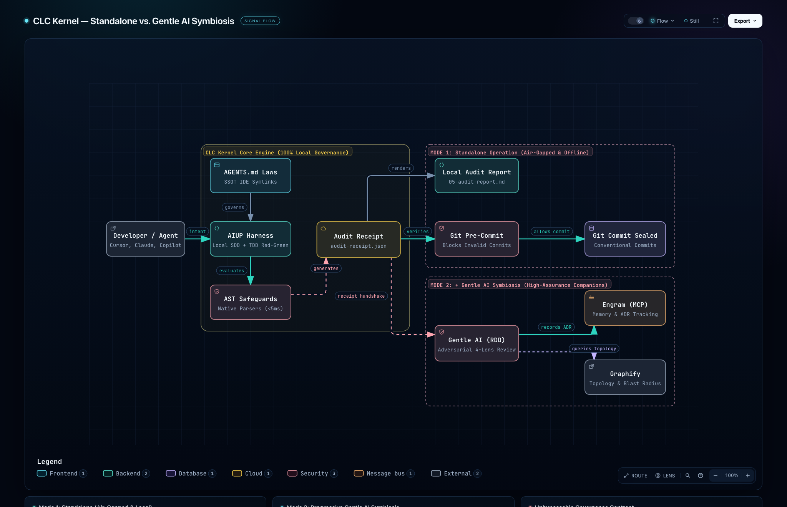
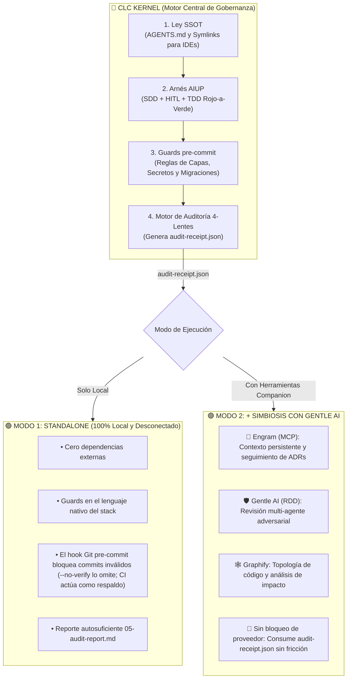

<div align="center">
  

# 🤖 CLC Kernel (`clckernel`)

[](https://www.npmjs.com/package/clckernel)
[](LICENSE)
[](./README.md)

**El Motor Universal de Gobernanza Determinista para Agentes de IA & Orquestador AIUP.**
*Creado por [CarlosLeonCode](https://github.com/carlosleoncode).*
</div>

Los agentes de programación con IA (Cursor, Claude Code, Windsurf, Copilot) codifican a gran velocidad, pero sin límites introducen degradación arquitectónica, tests falsos positivos y fuga de credenciales.

**CLC Kernel** es un arnés de desarrollo políglota que gobierna a los agentes mediante **guards pre-commit deterministas** (verificaciones basadas en patrones, más guards con Python AST en stacks Python), **especificaciones SDD locales** y el cumplimiento del **Proceso Unificado de IA (AIUP)**.

---

## 📋 Tabla de Contenidos
- [🎯 Casos de Uso](#-casos-de-uso)
- [🏛️ El Proceso Unificado de IA (AIUP)](#️-el-proceso-unificado-de-ia-aiup)
- [🔍 Desarrollo Guiado por Revisión (RDD) y los 4 Lentes](#-desarrollo-guiado-por-revisión-rdd-y-los-4-lentes)
- [⚡ Guía Paso a Paso (Ciclo Completo)](#-guía-paso-a-paso-ciclo-completo)
- [🧭 Qué ocurre después de instalar](#despues-de-instalar)
- [🎮 Interfaz Universal de Comandos](#-interfaz-universal-de-comandos)
- [🔄 Actualización de Proyectos Existentes](#-actualización-de-proyectos-existentes)
- [⚙️ Configuración (`.clckernel.yaml`)](#configuracion)
- [🌐 Ecosistemas Soportados y Arquetipos](#-ecosistemas-soportados-y-arquetipos)
- [⚠️ Limitaciones conocidas](#limitaciones-conocidas)
- [🏛️ Arquitectura: Standalone vs. Simbiosis con Gentle AI](#-arquitectura-standalone-vs-simbiosis-con-gentle-ai)
- [🧩 Herramientas Complementarias (Opcionales)](#-herramientas-complementarias-opcionales)
- [📖 Glosario de Términos Clave](#-glosario-de-términos-clave)
- [🤝 Contribuciones y Comunidad](#-contribuciones-y-comunidad)
- [📄 Licencia](#-licencia)

---

<a id="casos-de-uso"></a>
## 🎯 Casos de Uso

| Caso de Uso | Problema que Resuelve | Cómo lo Resuelve CLC Kernel |
|---|---|---|
| **1. Gobernanza de Coding Agents**<br>*(Cursor, Claude Code, Copilot)* | Los agentes programan por intuición ("vibe coding"), se saltan pruebas y rompen capas de arquitectura en backend y frontend. | Impone la **Regla #0** (Investigación -> SDD -> TDD Rojo a Verde -> Auditoría) y bloquea commits no conformes mediante el hook pre-commit (`--no-verify` lo omite; CI actúa como respaldo). |
| **2. Arquetipos Agent-OS y Flujos de Dominio**<br>*(Agentes autónomos y runtimes de agentes)* | Runtimes de agentes ejecutan acciones sin supervisión, inventan datos o desincronizan reglas en diferentes IDEs. | Provee **Gobernanza Dual-Layer** y guards para cualquier repositorio de agentes: marcadores Human-in-the-Loop explícitos en skills y playbooks (`check_hitl`), frontmatter de SKILL.md (`check_skills`), links relativos (`check_links`), placeholders olvidados (`check_placeholders`), archivos de datos JSON que parsean (`check_data_files`) y mirrors de reglas que apuntan a AGENTS.md (`check_symlinks`). Las reglas de dominio pertenecen al proyecto: los guards de `tools/guards/` se ejecutan en el hook y en el audit. |
| **3. Refactorizaciones y Migraciones Críticas** | Los agentes modifican archivos fuera del alcance acordado, introduciendo regresiones silenciosas. | Delimita el trabajo en una especificación local `sdds/{cambio}/spec.md`; el alcance es un protocolo que aplica el agente (ningún guard lo verifica). |
| **4. Blindaje Pre-Commit y Shift-Left en CI/CD** | Fuga de credenciales, consultas N+1 en bucles y migraciones destructivas llegan a ramas remotas. | Ejecuta validaciones sin dependencias foráneas en el lenguaje nativo del stack antes de cada commit: guards basados en patrones en todos los stacks y guards con Python AST (capas, heurística N+1) en stacks Python. |

---

<a id="aiup"></a>
## 🏛️ El Proceso Unificado de IA (AIUP)

```
┌─────────────────────────────────────────────────────────────────────────────┐
│                       AI UNIFIED PROCESS (AIUP)                             │
├─────────────┬─────────────┬─────────────┬──────────────────┬────────────────┤
│   1. SDD    │   2. HIT    │   3. TDD    │    4. GUARDS     │   5. MIRROR    │
│ Spec-Driven │ Human-in-the│ Transición  │ Hook pre-commit  │ Single Source  │
│ Development │    Loop     │ Rojo-a-Verde│  determinista    │ of Truth Sync  │
└─────────────┴─────────────┴─────────────┴──────────────────┴────────────────┘
```

1. **SDD (Spec-Driven Development):** El agente debe redactar una especificación técnica local gitignorada (`sdds/{feature}/spec.md`) antes de tocar código de producción.
2. **HIT (Human-in-the-Loop):** El ingeniero revisa y aprueba los contratos y escenarios de prueba antes del inicio de la implementación.
3. **TDD (Rojo a Verde):** El agente debe demostrar un test de regresión fallido (Fase Roja) antes de escribir la solución en producción (Fase Verde).
4. **Guards (Salvaguardas Deterministas):** Scripts basados en patrones (y parsers Python `ast` en stacks Python) inspeccionan el diff preparado; el hook pre-commit bloquea los commits no conformes (`--no-verify` lo omite; CI actúa como respaldo).
5. **SSOT (Única Fuente de Verdad):** `AGENTS.md` se define una sola vez y se proyecta mediante symlinks hacia `CLAUDE.md`, `GEMINI.md`, `.cursorrules`, `.cursor/rules/clckernel_context.mdc`, `.github/copilot-instructions.md` y `.antigravity/rules.md` (la `mirrors.list` por defecto).

---

<a id="rdd-y-lentes"></a>
## 🔍 Desarrollo Guiado por Revisión (RDD) y los 4 Lentes

CLC Kernel estructura todas sus compuertas de auditoría bajo los principios de **Review-Driven Development (RDD)**, con los resultados de los guards agrupados en **4 lentes** mediante una tabla estática nombre → lente:

```
┌─────────────────────────────────────────────────────────────────────────────┐
│                       RESULTADOS AGRUPADOS EN 4 LENTES                      │
├─────────────────────┬───────────────────┬───────────────────┬───────────────┤
│    🎯 CORRECTITUD   │    🛡️ SEGURIDAD   │  🏛️ ARQUITECTURA  │ ⚡ RENDIMIENTO│
│ Bugs funcionales,   │ Fuga de secretos, │ Violación capas,  │ Heurística N+1│
│ scope drift, TDD,   │ bypass permisos,  │ límites de dominio│ tamaño bundle,│
│ contratos API       │ eval peligroso    │ deps circulares   │ memory leaks  │
└─────────────────────┴───────────────────┴───────────────────┴───────────────┘
```

`clckernel audit` (o `node tools/audit.js` / `python3 tools/audit.py`) imprime el resumen de 4 lentes y no
escribe nada. Pásale el cambio SDD al que pertenece — `clckernel audit --change <nombre>` (o
`node tools/audit.js --change <nombre>`) — y además escribe, solo en `sdds/<nombre>/`:
1. **Informe Educativo para Humanos (`05-audit-report.md`):** Explica detalladamente qué pasó, falló, advirtió o fue omitido agrupado por cada lente.
2. **Recibo Inmutable de Auditoría (`audit-receipt.json`):** Un archivo JSON inmutable y legible por máquina vinculado al `commitHash` actual que certifica el resultado (`PASSED`, `PASSED_WITH_WARNINGS` o `FAILED`) para compuertas automatizadas de revisión (como Gentle AI).

Con ambos orquestadores instalados (un stack mixto JS + Python), cada uno escribe su propio par para no
sobrescribir el del otro: `05-audit-report.js.md` / `audit-receipt.js.json` y `05-audit-report.py.md` /
`audit-receipt.py.json`.

CLI del orquestador: `audit.(js|py) [targetDir] [--hook] [--change <nombre>] [--staged]`. `<nombre>` debe ser un
solo segmento de ruta (letras, dígitos, `.`, `_`, `-`); `--staged` explicita el snapshot por defecto (los cambios
en stage, o el último commit si no hay nada en stage); `--hook` (lo usa el hook de pre-commit) imprime una línea
por guard y no se combina con `--change`; cualquier otro flag sale con 2 y el uso. Un guard que falla con nivel
`warning` — lo fija el guard (`level: 'warning'` en su resultado) o `severities` en `.clckernel.yaml` — se
imprime como `WARN` y no hace fallar la auditoría ni el commit; un guard que crashea siempre falla.

---

<a id="guia-paso-a-paso"></a>
## ⚡ Guía Paso a Paso (Ciclo Completo)

```
[1. Terminal]           [2. Chat del LLM]            [3. Bucle TDD]                [4. Git Commit]
npx clckernel   ───►   clckernel start   ───►   "Feature X con harness"   ───►   Hooks Pre-commit
(Bootstrap)            (Setup Interactivo)          (SDD -> HIT -> Tests)         (Guards & Secretos)
```

### 1️⃣ Paso 1: Inicializar el Repositorio (Terminal)
```bash
npx clckernel            # interactivo: muestra el stack detectado y pregunta antes de escribir
npx clckernel . --yes    # no interactivo (con --dry-run solo muestra el plan)
```
Detecta el framework, genera `AGENTS.md`, crea los mirrors para los agentes de IA (symlinks a `AGENTS.md`: `CLAUDE.md`, `GEMINI.md`, `.cursorrules`, `.cursor/rules/clckernel_context.mdc`, `.github/copilot-instructions.md`, `.antigravity/rules.md`), escribe el hook de pre-commit e instala scripts de guards nativos en `tools/`. Termina con un bloque **Next steps**; ver [Qué ocurre después de instalar](#despues-de-instalar).

### 2️⃣ Paso 2: Inicializar en el Chat del IDE (CLI Conversacional)
Abre tu agente de IA (Claude Code, Gemini CLI, Cursor, Copilot, Antigravity o cualquier agente que lea `AGENTS.md`) y escribe:
> `clckernel start`

`start` es un comando del agente (la CLI lo rechaza): el agente escanea tu código, propone un plan de gobernanza adaptado a tu stack, instala el arnés con `npx clckernel . --yes` si falta y escribe `.clckernel.yaml` solo para los ajustes que quieras cambiar (el archivo es opcional). Si mantienes los valores por defecto, escribe un `.clckernel.yaml` que solo contiene un comentario, lo que cierra el onboarding de la primera sesión.

### 3️⃣ Paso 3: Desarrollar con el Arnés AIUP
Al solicitar una funcionalidad o corrección, indica al agente:
> *"Implementa el endpoint de autenticación. **Usa el harness de CLC Kernel**."*

El agente ejecutará de forma autónoma el ciclo AIUP completo:
1. **Investigación y Causa Raíz:** Inspecciona el código base y dependencias.
2. **Especificación SDD Local:** Redacta contratos de API y planes de prueba en `sdds/{cambio}/spec.md`.
3. **Revisión HIT:** Solicita tu revisión y aprobación de los contratos propuestos.
4. **Fase Roja TDD:** Escribe un test de regresión que falle demostrando el requerimiento.
5. **Implementación Verde:** Escribe el código mínimo necesario respetando el aislamiento de capas.
6. **Compuerta de Auditoría:** Ejecuta `node tools/audit.js --change <nombre>` y emite el resumen de verificación (informe en `sdds/<nombre>/`).
7. **Entrada del Journal:** Con `check_journal` instalado, ejecuta `npx clckernel journal <nombre>` y completa la entrada desde el SDD, commiteada con el cambio (ver [Entradas del journal](#journal)).

### 4️⃣ Paso 4: Verificación Determinística de Guards (Git Commit)
```bash
git add .
git commit -m "feat(auth): add user authentication endpoint"
```
Los hooks pre-commit ejecutan automáticamente los guards instalados (por ejemplo Clean Architecture, Fuga de Secretos o Reversibilidad de Migraciones, según el stack). Cualquier violación queda **bloqueada por el hook pre-commit** (`--no-verify` lo omite; CI actúa como respaldo).

El escaneo de secretos (`scan_secrets`, en todos los stacks) detecta claves privadas, tokens de AWS, Stripe, OpenAI, Anthropic, Google, Slack y GitHub, JWTs, asignaciones entre comillas de claves, secretos y contraseñas, y valores con nombre de secreto en archivos `.env` commiteados (se omiten `.env.example`, `.env.sample` y `.env.template`). Una línea que lleva el marcador `clckernel: allow-secret` (en un comentario de cualquier sintaxis) no se reporta; el marcador cubre solo esa línea. Para dejar fixtures de tests o ejemplos de documentación fuera del escaneo, use `guard_exclude` (ver [Configuración](#configuracion)).

El hook se escribe en `.githooks/pre-commit` (y `core.hooksPath` apunta a `.githooks` en la configuración local de git del repositorio), o en `.husky/pre-commit` cuando Husky ya ejecuta los hooks del repositorio. `core.hooksPath` no se modifica cuando el directorio no es la raíz de un repositorio git o cuando otro gestor de hooks lo controla; en ese caso el bloque Next steps imprime el comando que activa el hook. El hook no enumera guards: llama a los orquestadores de auditoría (`node tools/audit.js --hook`, `python3 tools/audit.py --hook`, cada uno si está instalado) y luego a las herramientas externas del stack (linters, test runners) cuando están disponibles. Los orquestadores descubren todos los guards — los del kernel y los propios del proyecto, ya sea en la raíz de `tools/` (`check_*`, `scan_*`, `verify_*`, `*_guard`) o en `tools/guards/` — y ejecutan cada uno exactamente una vez, así que el hook de commit y `clckernel audit` siempre ejecutan el mismo conjunto.

### 5️⃣ Paso 5: Auditar la Salud del Repositorio en Cualquier Momento (Doctor)
```bash
npx clckernel doctor
```
Verifica `AGENTS.md`, `sdds/`, `docs/Journal/`, `tools/`, el hook de pre-commit, que cada script de guard cargue (JS) o parsee (Python) y los imports de los orquestadores de auditoría. No ejecuta los tests.

---

<a id="despues-de-instalar"></a>
## 🧭 Qué ocurre después de instalar

### En la terminal: Next steps
Una instalación real (no `--dry-run`) termina con un bloque **Next steps** construido a partir de lo que se
instaló. La CLI lo imprime en inglés; para un proyecto Next.js dentro de un repositorio git dice:

```text
Next steps
  1. Review and commit the harness: git add -A && git commit -m "chore: install clckernel"
     The pre-commit hook (.githooks/pre-commit) runs on this commit.
  2. Open your AI agent and ask it to run clckernel start to tailor the rules (.clckernel.yaml),
     or just start working: it follows AGENTS.md.
     AGENTS.md mirrors written for: Claude Code (CLAUDE.md), Gemini (GEMINI.md), Cursor, Copilot, Antigravity.
  3. Run npx clckernel audit anytime to see every guard's result.
  4. Project-specific checks go in tools/guards/ (the hook and the audit run them).
  5. Later, preview kernel updates with npx clckernel update --dry-run.
```

- Cuando el hook no está activo (sin repositorio git, en un subdirectorio del repositorio, o con
  `core.hooksPath` controlado por otro gestor de hooks), el paso 1 imprime primero el comando que lo activa,
  p. ej. `git init && git config core.hooksPath .githooks`, y luego el commit.
- En una instalación full-stack o monorepo, el paso 1 agrega que el hook ejecuta las verificaciones de cada
  parte desde la raíz del repositorio.
- El paso 2 lista solo los mirrors que esta ejecución escribió o encontró al día. Un archivo con el mismo
  nombre que no es un symlink (por ejemplo, tu propio `CLAUDE.md`) se conserva, y ese agente lee tu archivo en
  lugar de `AGENTS.md`. Si no se escribió ningún mirror, el paso 2 indica usar un agente que lea `AGENTS.md`
  directamente.
- `clckernel update` imprime un bloque Next steps más corto solo cuando algo requiere atención: una copia
  `*.clckernel-new` para fusionar, o guards disponibles con `--add-guards`.

### En tu agente de IA: la primera sesión
Todos los agentes leen la misma ley: Claude Code (`CLAUDE.md`), Gemini (`GEMINI.md`), Cursor (`.cursorrules`,
`.cursor/rules/clckernel_context.mdc`), Copilot (`.github/copilot-instructions.md`) y Antigravity
(`.antigravity/rules.md`) mediante los mirrors por defecto; Windsurf mediante `.windsurfrules` cuando está en
`mirrors.list` al instalar; agentes como Codex u OpenCode leen `AGENTS.md` directamente.

Cada `AGENTS.md` generado termina con una sección **First session after install**. Aplica mientras exista
`tools/.clckernel-managed.json` y no exista `.clckernel.yaml`:

1. **Tu pedido va primero.** Si pides una tarea, el agente la realiza bajo las reglas y menciona el onboarding
   una sola vez, en una frase, al final.
2. **Si no, te orienta brevemente:** qué instaló el kernel (`tools/.clckernel-managed.json`) y qué ejecuta el
   hook de pre-commit en cada commit.
3. **Hace UNA pregunta** y espera: adaptar las reglas ahora con `clckernel start`, o mantener los valores por
   defecto. Mantenerlos escribe un `.clckernel.yaml` que solo contiene un comentario, así la pregunta no se
   repite.

La skill `clckernel_cli` también se activa en esa primera sesión. Los proyectos instalados antes de que
existiera esta sección no la reciben con `update`: update solo reescribe las secciones del kernel de un
`AGENTS.md` existente (ver *AGENTS.md* en [Actualización de proyectos existentes](#actualizacion-de-proyectos-existentes)) y agrega la fila `clckernel update` a
su tabla de comandos si falta. Para obtener la sección, cópiala del `AGENTS.md` de una instalación nueva.

---

<a id="interfaz-universal-de-comandos"></a>
## 🎮 Interfaz Universal de Comandos (Todos los LLMs y Agentes)

CLC Kernel define una gramática de comandos en `AGENTS.md`, que los agentes leen a través de sus mirrors (**Claude Code, Gemini, Cursor, Copilot, Antigravity**; Windsurf cuando `.windsurfrules` está en `mirrors.list`) o directamente (agentes que leen `AGENTS.md` por sí mismos):

| Comando | Categoría | Protocolo de Ejecución Obligatorio |
|---|---|---|
| `clckernel feature <nombre>` | Funcionalidad | Ciclo AIUP completo: Investigación -> Spec Local (`sdds/{nombre}/spec.md`) -> Revisión HIT -> Fase Roja TDD -> Implementación Verde -> Auditoría. |
| `clckernel fix <descripción>` | Corrección | Análisis de causa raíz (sin editar código) -> Test de regresión que falle -> Corrección quirúrgica limpia -> Compuerta de auditoría. |
| `clckernel test` | Verificación | Ejecuta la suite de pruebas en el runner nativo del stack y confirma estado verde limpio. |
| `clckernel audit` | Verificación | Ejecuta `node tools/audit.js` y/o `python3 tools/audit.py` y emite el Resumen Educativo; con `--change <nombre>` también escribe el informe y el recibo en `sdds/<nombre>/`. |
| `clckernel doctor` | Diagnóstico | Ejecuta `npx clckernel doctor [dir]`: verifica AGENTS.md, sdds/, tools/, el hook de pre-commit y que los scripts de guards carguen. |
| `clckernel commit <mensaje>` | Control de Versiones | Auditoría pre-flight, verificación de scope diff vs SDD y commit con Conventional Commits (cero atribución de IA). |
| `clckernel guard create <nombre>` | Salvaguardas | Genera el scaffold de un nuevo script de guard en el lenguaje nativo del stack en `tools/guards/`; el hook de pre-commit y el audit ejecutan cada guard del proyecto (`tools/guards/*.js`/`*.py`, y los archivos `check_*`/`scan_*`/`verify_*` no gestionados en la raíz de `tools/`). |
| `clckernel report-bug <resumen>` | Bug del Kernel | Cuando la causa raíz está en un archivo del kernel: nunca lo parchea en su proyecto; ofrece un workaround temporal en `.clckernel.yaml`, prepara un reporte del bug y explica el camino fork + pull request (o un issue), con su aprobación en cada paso hacia afuera. |
| `clckernel update` | Mantenimiento | Actualización no destructiva: refresca herramientas core, skills y symlinks de IDEs sin sobreescribir SDDs, guards personalizados ni `.clckernel.yaml`. |
| `clckernel start` | Configuración | Comando del agente: detecta el stack, propone el ciclo de vida AIUP e instala el arnés (`npx clckernel . --yes`) si falta; `.clckernel.yaml` es opcional y solo se escribe para ajustes distintos de los valores por defecto (mantener los valores por defecto escribe un archivo con solo un comentario). |

---

<a id="actualizacion-de-proyectos-existentes"></a>
## 🔄 Actualización de Proyectos Existentes (No Destructiva)

Cuando se publican nuevas versiones de CLC Kernel con nuevos guards, playbooks actualizados o reglas optimizadas para IDEs, puedes actualizar tu repositorio de forma segura sin perder tu trabajo:

```bash
npx clckernel update
```
O directamente desde el chat de tu agente IA:
```bash
clckernel update
```

### 🔒 La Garantía de Actualización No Destructiva:
- **Refresca y Actualiza:** Orquestadores centrales (`tools/audit.js`, `tools/audit.py`), los guards nativos que tu proyecto tiene, Skills de agentes (`.agents/skills/`) y los symlinks de IDEs que tu proyecto tiene (`CLAUDE.md`, `GEMINI.md`, `.cursorrules`, Copilot, Antigravity).
- **100% Preservado:**
  - `sdds/`: Todas las especificaciones locales, planes y recibos de verificación permanecen intactos.
  - Los guards del proyecto (`tools/guards/`, y los archivos de guard en la raíz de `tools/` que el kernel no gestiona) se conservan sin modificaciones. Un guard del kernel que el kernel ya no distribuye queda exactamente donde está, sale del registro y sigue ejecutándose como guard del proyecto; `update` lo informa como "retired kernel guard kept as project guard".
  - `.clckernel.yaml`: nunca se reescribe; update lo lee (ver [Configuración](#configuracion)).
  - El código fuente de la aplicación y modelos de dominio jamás se tocan.

### 🛡️ Los archivos que editaste nunca se sobrescriben
`update` (y una reinstalación con `--yes`) sólo sobrescribe un archivo del kernel (`tools/*`, el hook de
pre-commit, la skill `clckernel_cli`) cuando puede probar que es suyo y está intacto: su sha256 coincide con el
del registro (`tools/.clckernel-managed.json`) o con una versión que el kernel publicó. Todo lo demás — un guard
que endureciste, un archivo del proyecto que comparte nombre con uno del kernel — se conserva byte a byte, y la
versión nueva se escribe al lado como `<archivo>.clckernel-new` (ignorado por git) para que la revises y
fusiones. El resumen lista lo escrito, sin cambios, protegido, movido, agregado a `.gitignore` y configurado en
`git config`.

Previsualiza primero con `--dry-run`: imprime el mismo resumen como plan y no escribe nada (ni archivos, ni
`.gitignore`, ni `git config`):
```bash
npx clckernel update . --dry-run
npx clckernel . --yes --dry-run
```

### ➕ `update` nunca agrega lo que no elegiste
`update` actualiza lo que el proyecto ya tiene; nunca agrega guards ni mirrors de IDE por su cuenta:
- **Guards:** sólo se actualizan (y corre el hook) los guards del registro o presentes en `tools/`. Los
  guards nuevos de tu stack se listan como *available, not installed*; se agregan con `--add-guards` (desde
  ahí quedan instalados y se actualizan). `--add-guards` acepta cualquier guard incluido en el catálogo,
  también uno que tu stack no instala (p. ej. `check_api_contracts`, `check_storybook`, `check_scope`):
  update avisa que no es parte del stack detectado, lo registra en el registro (`extraGuards`) y lo actualiza
  como a los demás. Un nombre fuera del catálogo (o una CLI externa) falla con exit 1 y no escribe nada. Los
  archivos de soporte (`_changes.js/.py`, los lectores de config `_config.js/.py`, `yaml.js`, `_yaml.py`, los
  orquestadores de audit, `tools/package.json`) siguen a los guards instalados.
- **Tecnologías detectadas desde la última corrida:** la única excepción. El registro guarda las
  tecnologías detectadas en install/update (`technologies`); una que apareció después (un `Dockerfile`, un
  `supabase/config.toml`, un cliente de datos o el SDK de MCP en un `package.json`) trae su guard, listado como
  *added for newly detected technologies* (`--dry-run`: *would add*). Un registro de una versión anterior no
  tiene la lista: ese update registra las tecnologías actuales como base y no agrega nada (sus guards se
  listan como disponibles; agrégalos con `--add-guards`). Un guard que quitas sigue fuera.
- **AGENTS.md:** las secciones del kernel son la tabla *Parts* y *Core AI Safeguards* de un `AGENTS.md`
  full-stack o monorepo, o la sección *2. Core AI Safeguards (<stack>)* de un solo stack. Sus líneas siguen a
  los guards instalados (un guard que quitaste no se promete; uno agregado con `--add-guards` se lista). El
  registro guarda un sha256 de cada sección tal como la escribió el kernel (`agentsSections`). `update`
  reescribe una sección solo si su texto conserva ese hash o ya es igual al texto nuevo. Si editaste una, o
  una instalación anterior no guardó hash y el texto difiere, `AGENTS.md` queda como está y el archivo
  refrescado se escribe al lado como `AGENTS.md.clckernel-new` para que lo fusiones (listado como protegido).
  El resto de secciones nunca se toca, un documento sin esos encabezados no se toca, `update.exclude:
  [AGENTS.md]` lo deja fuera por completo y `--dry-run` no escribe nada.
- **Mirrors:** un mirror que borraste (p. ej. `.cursor/rules/clckernel_context.mdc`) no se recrea; se reporta
  como *not present (skipped)*. Una instalación nueva los sigue creando todos.
- **`.gitignore`:** una entrada cuya ruta git trackea (un mirror o la skill que commiteas) nunca se agrega, ni
  en install ni en update; se reporta como *tracked, not ignored*.
```bash
npx clckernel update . --add-guards check_skills,check_placeholders
npx clckernel update . --add-guards all
```

### 🆕 Qué hay de nuevo desde tu versión
El registro guarda la versión del kernel de la última instalación o actualización (`kernelVersion`). `update`
lista cada guard incluido que salió después en una sección *New since <instalada> (<actual>)*, después de
*available, not installed*: qué revisa, `[blocks commits]` cuando su nivel por defecto bloquea un commit,
`(installed)` cuando el proyecto ya lo tiene, qué revisar antes de adoptarlo y el comando `--add-guards` que lo
agrega. Nada se instala por su cuenta. Un registro sin `kernelVersion`, o un proyecto que ya está en la versión
actual, no muestra esa sección.

Para agentes, `--json` (con o sin `--dry-run`) imprime un solo objeto JSON en stdout en lugar del texto (sin
banner ni colores): `contract` (`clckernel.update-plan/v1`), `success`, `dryRun`, `kernelVersion`
(`installed`, `current`), `plan`, `whatsNew` (`name`, `since`, `checks`, `blocking`, `adopt`, `installed`,
`inStack`, `command`), `warnings`, `preserved`, `retiredGuards`, `legacyCleanup` y `nextSteps`. Ante un
error imprime `{ contract, success: false, error }` y sale con 1. El playbook de `update` corre
`--dry-run --json`, revisa contigo cada guard nuevo y agrega solo los que apruebes.
```bash
npx clckernel update . --dry-run --json
```

<a id="journal"></a>
### 📓 Entradas del journal (opcional: `check_journal`)
`sdds/` está en `.gitignore`, así que el *por qué* de cada cambio se queda en la máquina que lo escribió. El
journal es el registro commiteado: un archivo Markdown corto por cada cambio SDD auditado,
`docs/Journal/<YYYY>/<YYYYMMDDTHHMMZ>-<cambio>.md` (timestamp UTC: los nombres se ordenan por fecha y dos ramas
no chocan), con frontmatter `change:` y `date:` y cuatro secciones: `## Context`, `## Decision`,
`## Alternatives`, `## Consequences`. No hay índice: un agente lista la carpeta del año y lee las entradas que
tocan el área en la que trabaja. Los ADRs numerados que ya están en `docs/Journal/` quedan como están.

`npx clckernel journal <cambio> [targetDir]` crea la entrada desde una plantilla (el nombre `<cambio>` sigue la
regla de `audit --change`) y se niega si el cambio ya tiene una; vos o tu agente la completan desde el SDD.
El guard `check_journal` no se instala por defecto: se agrega con
`npx clckernel update . --add-guards check_journal`. Desde entonces, por cada `sdds/<cambio>/audit-receipt*.json`
cuyo `commitHash` es el HEAD actual (el cambio auditado que estás por commitear), el hook bloquea el commit hasta
que la entrada de ese cambio esté en el índice o en HEAD, y toda entrada staged bajo `docs/Journal/<YYYY>/` debe
tener un nombre válido, su `change:`, las cuatro secciones y como máximo `journal.max_lines` líneas. Los
receipts de otros commits se ignoran, así que adoptarlo no pide nada para los cambios anteriores; adoptalo entre
cambios. Los receipts son locales: sin `sdds/` (CI, un clon nuevo) el guard se salta y lo dice.
```bash
npx clckernel journal add-cache .
```

---

<a id="configuracion"></a>
## ⚙️ Configuración (`.clckernel.yaml`)

Opcional. Sin el archivo rige cada valor por defecto de abajo (el comportamiento de un proyecto sin
config). Install, update y cada guard lo leen desde la raíz del proyecto; un valor inválido los detiene
con `Invalid .clckernel.yaml: key "<key>" — <motivo>` (no se escribe nada, el commit se bloquea).

| Clave | Efecto | Por defecto | La lee |
|---|---|---|---|
| `rules` | Reglas regex propias (`name`, `pattern`, `message`, opcionales `severity`, `scope`, `exclude`) sobre los archivos cambiados | ninguna | `check_custom` |
| `exclude_paths` | Globs que ningún guard basado en el diff evalúa (secretos, verificador TDD, reglas propias, …): todos los guards dejan de verlos; para silenciar un solo guard, prefiera `guard_exclude` | ninguno | `_changes.js/.py` |
| `mirrors.list` | Mirrors de IDE (symlinks a `AGENTS.md`) que install crea y `check_symlinks` verifica | install: `CLAUDE.md`, `GEMINI.md`, `.cursorrules`, `.cursor/rules/clckernel_context.mdc`, `.github/copilot-instructions.md`, `.antigravity/rules.md`; `check_symlinks`: `CLAUDE.md`, `GEMINI.md`, `.cursorrules`, `.windsurfrules` | install/update, `check_symlinks` |
| `mirrors.required` | `true`: un mirror listado que falta hace fallar `check_symlinks` | `false` | `check_symlinks` |
| `hitl.markers` | Regex (sin distinguir mayúsculas, una línea, fuera de bloques de código) que cuentan como marcador Human-in-the-Loop; reemplazan a los de por defecto | una línea `HITL:` o un encabezado `## Human checkpoint` / `## HITL` | `check_hitl` |
| `hitl.paths` | Globs de los archivos cambiados que evalúa `check_hitl` | skills (`SKILL.md`, `skills/*.md` planos) y `playbooks/**/*.md` | `check_hitl` |
| `hitl.optOut` | `{ key, value }`: un archivo cuyo frontmatter tiene `key: value` queda exento | ninguno | `check_hitl` |
| `update.exclude` | Globs relativos a la raíz que install y update nunca escriben, mueven ni borran; se listan como *excluded by config* | ninguno | install/update |
| `tdd.code` | Globs extra que cuentan como código de producción (cualquier lenguaje), p. ej. tools en Python testeadas con tests JS | ninguno | `verify_tdd.js/.py` |
| `tdd.ignore` | Globs que quedan fuera del chequeo red→green, sean código o tests (p. ej. `e2e/**` para specs de otro runner); definir la clave reemplaza el default | código generado: `**/database.types.ts`, `**/*.generated.*`, `**/*.gen.*`, `**/__generated__/**`, `**/generated/**` | `verify_tdd.js/.py` |
| `severities` | `{ <nombre del guard>: warning \| error }`: un guard que falla en `warning` se reporta (`WARN`, veredicto `PASSED_WITH_WARNINGS`) pero no bloquea; `error` bloquea aunque el guard reporte `level: 'warning'`. Un crash siempre bloquea | el nivel propio de cada guard (`error` salvo que reporte `warning`) | `audit.js` / `audit.py` (auditoría y hook de pre-commit) |
| `guard_exclude` | `{ <nombre del guard>: [globs] }`: archivos cambiados que un solo guard nunca evalúa; los demás guards los siguen viendo. El nombre del guard es el de su archivo sin extensión (`scan_secrets`, `check_custom`, el nombre propio de un guard de `tools/guards/`); se acepta cualquier nombre | ninguno | `_changes.js/.py`, para el guard que nombran los orquestadores de auditoría (o una ejecución directa) |
| `sql_migrations.paths` | Globs de los archivos de migración SQL; una carpeta configurada que existe también instala el guard | `**/supabase/migrations/**/*.sql` | `check_sql_migrations`, install/update |
| `sql_migrations.schemas` | Esquemas cuyo `create table` necesita `enable row level security` en el mismo archivo | `public` | `check_sql_migrations` |
| `sql_migrations.anon_roles` | Roles que no deben recibir `grant` de `insert` / `update` / `delete` / `all` | `anon` | `check_sql_migrations` |
| `sql_migrations.severities` | `{ immutable, rls, search_path, anon_write, destructive }`: `error`, `warning` u `"off"` (entre comillas: un off sin comillas se rechaza) por regla | `destructive: warning`, el resto `error` | `check_sql_migrations` |
| `query_efficiency.call_patterns` | Regex extra de llamadas a consultas (sobre el código sin comentarios ni texto literal), para cualquier archivo | ninguno (los presets siguen al cliente de datos del archivo) | `check_query_efficiency` |
| `query_efficiency.severities` | `{ n_plus_one, unbounded_select }`: `error`, `warning` u `"off"` (entre comillas) | ambas `warning` (`n_plus_one` es una heurística; pon `error` para bloquear) | `check_query_efficiency` |
| `mcp_contracts.contracts_modules` | Módulos (y sus subrutas) de los que deben importarse los esquemas de entrada de los tools; configurarlo activa `inline_schema` y `schema_source` | ninguno: cualquier esquema, inline o local, pasa | `check_mcp_contracts` |
| `mcp_contracts.forbid_data_clients` | `true`: un archivo que registra tools no puede importar un cliente de datos | `false` | `check_mcp_contracts` |
| `mcp_contracts.severities` | `{ missing_schema, inline_schema, schema_source, data_client }`: `error`, `warning` u `"off"` (entre comillas) | todas `error` | `check_mcp_contracts` |
| `ui_reuse.primitives` | Globs de los primitivos de UI, exentos de las reglas de `<button>` / `<input>` / `<select>` crudos | `**/components/ui/**` | `check_ui_reuse` |
| `journal.dir` | Carpeta de las entradas del journal (`<dir>/<YYYY>/<YYYYMMDDTHHMMZ>-<cambio>.md`), dentro del proyecto | `docs/Journal` | `check_journal`, `clckernel journal` |
| `journal.max_lines` | Máximo de líneas de una entrada del journal (un entero positivo) | `80` | `check_journal` |

```yaml
exclude_paths: ["vendor/**"]
mirrors:
  list: [CLAUDE.md, .github/copilot-instructions.md]
  required: true
hitl:
  optOut: { key: checkpoint, value: none }
update:
  exclude: [AGENTS.md]
tdd:
  code: ["tools/**/*.py"]
severities:
  check_seo: warning
guard_exclude:
  scan_secrets: ["tests/**", "**/tests/**", "**/*.md"]
sql_migrations:
  severities: { destructive: "off" }
mcp_contracts:
  contracts_modules: ["@acme/contracts"]
```

Prefiera `guard_exclude` a `exclude_paths` cuando un solo guard falla en falso sobre algunas rutas: con
`exclude_paths: ["tests/**"]` el verificador TDD también dejaría de ver los cambios en los tests, mientras que
`guard_exclude: { scan_secrets: ["tests/**"] }` deja las credenciales falsas de los fixtures de tests fuera
solo del escaneo de secretos. Igual que `exclude_paths`, filtra los archivos cambiados que evalúa un guard, no
el listado completo del repositorio contra el que algunos guards comprueban hechos (el destino de un enlace,
un marcador de proyecto).

Las claves que versiones anteriores aceptaban sin efecto alguno — `active_guards`, `phases`, `gate_mode`,
`layers`, `scope` — se ignoran con un aviso de deprecación; borralas. Una clave desconocida de
primer nivel se ignora con un aviso. Los guards lo leen con `tools/_config.js` (+ `yaml.js`) y
`tools/_config.py` (+ `_yaml.py`), instalados junto a `_changes.js/.py`, así que un archivo creado después de
instalar aplica de inmediato.

---

<a id="ecosistemas-soportados"></a>
## 🌐 Ecosistemas Soportados y Arquetipos

| Ecosistema | Firma de Detección | Test Runner | Salvaguardas Nativas |
|---|---|---|---|
| ⚛️ **Next.js** | `next` | Vitest / Jest | Clean Architecture, Reutilización de UI, Tokens Semánticos, RSC, A11y, Responsive, SEO |
| ⚡ **FastAPI** | `fastapi` | Pytest | Reversibilidad de Migraciones Alembic, Clean Architecture (Python AST), Heurística N+1 (Python AST), Verificador TDD Rojo→Verde (pytest) |
| 💎 **Rails** | `Gemfile` | RSpec | RuboCop, Seguridad Brakeman, Verificador TDD Rojo→Verde (RSpec / Minitest) |
| 🐹 **Golang** | `go.mod` | `go test` | `golangci-lint`, Aislamiento de Capas Dominio/Casos de Uso, Verificador TDD Rojo→Verde (`go test`) |
| 🦀 **Rust** | `Cargo.toml` | `cargo test` | `cargo clippy`, `cargo audit`, Seguridad Estricta de Memoria, Verificador TDD Rojo→Verde (`cargo test`, tests de integración) |
| 🐘 **Laravel** | `artisan` | Pest / PHPUnit | Análisis estático PHPStan, Verificador TDD Rojo→Verde (Pest / PHPUnit) |
| 🎸 **Django** | `manage.py` | `pytest-django` | Ruff, Clean Architecture (Python AST), Heurística N+1 (Python AST), Verificador TDD Rojo→Verde (pytest) |
| 🚀 **Astro** | `astro.config` | Playwright | Tokens Tailwind v4, Esquemas de Colección, A11y, Responsive, SEO |
| 🤖 **Agent-OS** | `skills/<nombre>/SKILL.md` (también `.agents/skills/`, `.claude/skills/`), `playbooks/` o `rules/` con Markdown; si el repo también tiene un stack de código, gana el stack de código | Tests de Contrato | AGENTS.md Dual-Layer, marcadores HITL (`check_hitl`), Skills (`check_skills`), Links (`check_links`), Placeholders (`check_placeholders`), Datos JSON (`check_data_files`), Mirrors (`check_symlinks`), Reglas propias (`check_custom`); guards del proyecto en `tools/guards/` |

### 🧱 Full-stack y monorepos

Un repositorio puede tener varias partes de código. `clckernel` busca un stack en la raíz, en los directorios
declarados como workspaces (`package.json#workspaces`, como lista o `{ packages }`, `packages:` de
`pnpm-workspace.yaml`, `packages` de `lerna.json` y `use` de `go.work`) y en los directorios convencionales
`frontend`, `backend`, `web`, `api`, `server`, `client`, `apps/*`, `services/*`, `packages/*` y `libs/*`
(hasta tres niveles; se omiten `node_modules`, `.git`, `vendor`, `dist` y `build`). Los patrones de workspace
se interpretan como directorios literales, segmentos `*` (`dir/*`, `dir/*/*`) o un `dir/**` final, que
desciende hasta un directorio con un manifiesto de paquete; otras formas de glob se ignoran, igual que los
nombres de directorio con caracteres distintos de letras, dígitos, `.`, `_` y `-` (p. ej. `@scope`).

- **Una parte en la raíz:** se instala exactamente igual que un repositorio de un solo stack.
- **Varias partes** (p. ej. Next.js en la raíz + `backend/` FastAPI, o `apps/web` + `apps/api`): el tipo de
  proyecto es `fullstack` (hay una parte en la raíz) o `monorepo` (solo subdirectorios). Dos stacks del mismo
  ecosistema en un directorio (p. ej. FastAPI y Django) siguen siendo una parte, y gana el primer adapter,
  como antes.
- **Partes de librería:** un subdirectorio con un manifiesto de paquete que ningún adapter de framework
  reconoce es una parte de librería de su ecosistema, y cuenta como parte por sí sola (un repositorio solo de
  librerías es `monorepo`; Next.js en la raíz más `packages/ui` es `fullstack`):

  | Parte | Manifiesto | Herramientas del hook (dentro de la parte) |
  |---|---|---|
  | `TypeScript Library` | `package.json` (o un `project.json` de Nx) + `tsconfig.json` | `tsc --noEmit` (su `node_modules/.bin/tsc`, o el de la raíz) |
  | `JavaScript Library` | `package.json` o un `project.json` de Nx | ninguna: solo los guards JS |
  | `Python Library` | `pyproject.toml`, `setup.py` o `setup.cfg` | `ruff`, `pytest` (el código 5, sin tests, pasa) |
  | `PHP Library` | `composer.json` (sin `artisan`) | `vendor/bin/phpstan`, `vendor/bin/pest` o si no `vendor/bin/phpunit` |
  | `Ruby Library` | `*.gemspec` o `Gemfile` (sin `config/routes.rb`) | `rubocop`, `rspec` (según `Gemfile.lock`), o si no Minitest con `rake test` |

  Los módulos Go y los crates Rust ya son partes con sus propios adapters. La raíz nunca es una parte de
  librería, así que un repositorio de un solo paquete se detecta como antes. Una `JavaScript Library` se
  descarta cuando otra parte node (Next.js, Astro, una librería TypeScript) ya instala los guards JS, porque no
  agrega nada, así que una raíz Next.js con paquetes JS simples en workspaces sigue siendo de un solo stack. Una
  raíz Agent-OS cuyas únicas partes serían librerías sigue siendo Agent-OS. Un `Cargo.toml` raíz con
  `[workspace]` es una sola parte: `cargo test` y `cargo clippy` en la raíz ya cubren los crates miembros, así
  que los miembros no son partes aparte.
- **Guards:** la unión de los guards de las partes se instala una vez en `tools/` de la raíz, con un
  orquestador de auditoría por lenguaje, y se ejecuta una vez desde la raíz.
- **Herramientas externas** (ruff, pytest, tsc, …) se ejecutan dentro del directorio de su parte; si una no
  está disponible se imprime `clckernel: <herramienta> (<dir>) not available, skipped`.
- **Verificador TDD Rojo→Verde:** cada archivo cambiado pertenece a su raíz de proyecto más cercana (Python:
  `pyproject.toml`, `requirements.txt`, `setup.cfg`, `setup.py`, `manage.py`; JS: `package.json`; Go: `go.mod`;
  Rust: `Cargo.toml`; Ruby: `Gemfile`; PHP: `composer.json`). Cada grupo
  se ejecuta en su raíz (`PYTHONPATH`, runner y `node_modules` de esa raíz, o los `node_modules` de la raíz
  del repositorio si están elevados). El código cambiado en una parte sin un test cambiado en esa misma parte
  falla.
- **AGENTS.md** lista cada parte (directorio, stack, test runner) con las reglas de su stack; `clckernel
  update` vuelve a detectar las partes.

<a id="rojo-verde-otros-stacks"></a>
#### Rojo→Verde en Go, Rust, Ruby y PHP

`tools/verify_tdd.js` (Node existe en todos los stacks) ejecuta los tests cambiados sobre el código staged (deben
pasar, con al menos un test ejecutado) y sobre `HEAD` más esos tests (deben fallar), en árboles materializados
desde git: Go `go test -v -count=1` sobre los paquetes de los `*_test.go` cambiados; Rust `cargo test --test <t>`
por cada test de integración (`tests/`), con un `CARGO_TARGET_DIR` temporal; Ruby `bundle exec rspec`
(`spec/**/*_spec.rb`) o `bundle exec ruby -Ilib -Itest` (`test/**/*_test.rb`); PHP `vendor/bin/pest`, si no
`vendor/bin/phpunit` (`tests/**/*Test.php`). El código de producción es `.go` (fuera de `vendor/`),
`src/**/*.rs`, `app|lib/**/*.rb` y `app|src/**/*.php`. Si falta `go`, `cargo`, `bundle`, `rspec-core` en el
lock (para specs) o `vendor/bin/{pest,phpunit}`, el chequeo falla con una pista de instalación. Limitaciones:
los tests unitarios `#[cfg(test)]` de Rust viven dentro del archivo de código y no se pueden separar para la
corrida roja, así que un cambio en `src/` necesita un test de integración cambiado en `tests/` (o una entrada
en `tdd.ignore`); Minitest corre con `ruby -Ilib -Itest`, no con `rails test`; Go se verifica por paquete; PHP
asume los bin proxies de Composer 2.2+.

<a id="guards-de-tecnologias"></a>
#### Guards de tecnologías

Install y `update` también buscan tecnologías en la raíz y en cada parte, y agregan su guard (JS, agnóstico
del stack; aparece en el resumen de instalación y en AGENTS.md):

| Tecnología | Se detecta por | Guard |
|---|---|---|
| Supabase / migraciones SQL | `supabase/config.toml`, o una carpeta configurada en `sql_migrations.paths` | `check_sql_migrations` |
| Cliente de base de datos | `@supabase/supabase-js`, `drizzle-orm`, `@prisma/client`, `postgres` o `pg` en un `package.json` | `check_query_efficiency` |
| Servidor MCP | `@modelcontextprotocol/sdk` en un `package.json` | `check_mcp_contracts` |
| Celery, Redis, PostgreSQL (Python), Docker | dependencias Python, `redis.conf`, `Dockerfile`, `docker-compose.yml` | `celery_guard`, `redis_guard`, `postgres_guard`, `docker_guard` |

- **`check_sql_migrations`** lee las migraciones cambiadas sentencia por sentencia (sin comentarios, literales
  de texto ni cuerpos entre dólares; sin distinguir mayúsculas): una migración aplicada que se modifica, borra
  o renombra (`immutable`; aplicada = presente en el merge-base con el upstream de la rama cuando lo tiene, si
  no en BASE, así que una migración que solo commiteaste localmente aún puede cambiar); un `create table` en un esquema revisado sin `enable row level
  security` en el mismo archivo (`rls`); una función o procedimiento `security definer` sin `set search_path`
  en su `create` ni en un `alter function … set search_path` posterior (`search_path`); `insert`/`update`/`delete`/`all` otorgado a un rol anónimo, incluido `alter default
  privileges` (`anon_write`); `drop table` / `drop [column]`, con el objeto nombrado (`destructive`, un
  warning). Los nombres sin esquema se resuelven al primer esquema del último `set search_path` del archivo
  (public si no hay); los identificadores entre comillas conservan mayúsculas (`"Items"` no es `items`). No ve:
  SQL armado en cadenas de `EXECUTE`, RLS habilitado en otra migración.
- **`check_query_efficiency`** (la contraparte JS/TS de `check_db_efficiency`) lee los archivos JS/TS cambiados
  cuyo `package.json` más cercano (o el de la raíz) depende de un cliente: una consulta con `await` en el cuerpo
  de un `for` / `for…of` / `for await` / `while` / `do`, o cualquier consulta en un callback `.forEach(` /
  `.map(async` / `.flatMap(async`, es un warning N+1 (una heurística: pon
  `query_efficiency.severities.n_plus_one: error` para bloquear); una sentencia que pagina (`.range(`,
  `.offset(`, `.skip(`, `skip` / `offset` / `cursor`, `OFFSET` en SQL) y una llamada dentro de una función
  definida en el cuerpo del bucle (un handler registrado por ruta) no son N+1. Las sentencias terminan en `;` o
  en un salto de línea que no las continúa; `.select('*')` de supabase-js sin `.limit(` / `.range(` /
  `.single(` / `.maybeSingle(` es un warning. Llamadas: supabase-js `.from(…).select|insert|update|upsert|delete(`
  y `.rpc(`; drizzle `db.`/`tx.` `select|insert|update|delete|execute(` y `db.query.<t>.findMany|findFirst(`;
  prisma `prisma.<modelo>.<operación>(`; postgres `` sql`…` ``; pg `client|pool|db.query(`. Omite tests y tipos
  generados (los globs por defecto de `tdd.ignore`). Falsos positivos conocidos: un bucle de pocas vueltas
  fijas, una llamada por lotes que es una sola consulta. No ve: un helper de consulta llamado dentro de un
  bucle, una consulta dentro de un callback que no sea `.forEach` / `.map` / `.flatMap` en un bucle, un cliente
  con otro nombre de variable, `.select()` sin argumentos.
- **`check_mcp_contracts`** lee los archivos JS/TS cambiados de paquetes que dependen del SDK de MCP. Un registro
  es `<x>.registerTool("nombre", { inputSchema, … }, cb)` (la API actual del SDK, verificada contra
  `@modelcontextprotocol/sdk` 1.32) o el obsoleto `<x>.tool("nombre", …)`. Por defecto solo exige un esquema de
  entrada por tool (`missing_schema`). Con `mcp_contracts.contracts_modules` configurado, un esquema inline
  (`z.object(…)`, `z.*`, un shape con miembros zod) falla (`inline_schema`) y un identificador de esquema no
  importado de esos módulos falla (`schema_source`); con `mcp_contracts.forbid_data_clients: true`, un archivo
  que registra tools e importa un cliente de datos (incluidos imports solo de tipos) falla (`data_client`). No sigue: un objeto de configuración pasado
  como variable, un esquema reexportado por un módulo local.

Fuera de alcance: Agent-OS como parte de un monorepo, repositorios git anidados o submódulos, elegir partes
manualmente en el prompt interactivo ("Elegir otro stack" instala un solo stack) y los path repositories de
Composer (las partes PHP solo se detectan por workspaces de otras herramientas y los directorios
convencionales).

---

<a id="limitaciones-conocidas"></a>
## ⚠️ Limitaciones conocidas

- **Windows no está probado.** El hook de pre-commit es un script de shell (`#!/usr/bin/env bash`, o `sh`
  con Husky): en Windows necesita un bash/sh como Git Bash.
- **Los archivos del kernel se declaran ante tus linters; los formatters no están cubiertos.** Cada archivo JS y
  Python que el kernel escribe en `tools/` empieza con pragmas de archivo: `/* eslint-disable */` (ESLint,
  oxlint), `// biome-ignore-all lint:` (Biome 2) y `// @ts-nocheck` (TypeScript `checkJs`); `# ruff: noqa`,
  `# flake8: noqa`, `# pylint: skip-file`, `# mypy: ignore-errors`, `# isort: skip_file` y `# fmt: off`
  (black, ruff format). La configuración del linter no necesita ignorar `tools/`, y `tools/guards/` (tu código)
  se sigue analizando. Huecos: Prettier y el formatter de Biome no tienen exclusión por archivo, así que si formatean
  `tools/` agregá las rutas de `tools/.clckernel-managed.json` a `.prettierignore` / `files.includes` de Biome;
  ESLint 9 reporta como warning un `eslint-disable` general que no suprime nada y `eslint --fix` (p. ej. desde lint-staged) lo
  borra (solo
  cuando tu configuración no reporta nada en ese archivo); `PGH004` de ruff (incluida en `ALL`) reporta el
  `noqa` general.
- **Proyectos con `"type": "module"`.** Los guards corren como CommonJS sea cual sea el tipo de módulo del
  proyecto: cuando install o update ponen un archivo JS en `tools/`, también escriben `tools/package.json`
  (`{ "type": "commonjs" }`), un archivo del kernel listado en el registro. Un `tools/package.json` propio se
  conserva (la versión del kernel va a `tools/package.json.clckernel-new`); si el tuyo declara
  `"type": "module"`, `npx clckernel doctor` falla el check *tools/ JS runs as CommonJS* y te dice qué cambiar.
  Los guards del proyecto en `tools/guards/` también son CommonJS.
- **Tests unitarios inline de Rust** (`#[cfg(test)]`): no se pueden separar para la corrida roja; ver
  [Rojo→Verde en Go, Rust, Ruby y PHP](#rojo-verde-otros-stacks).
- **Las instalaciones existentes conservan casi todo su `AGENTS.md`.** `update` solo refresca la tabla de
  partes y las listas de salvaguardas (sección 2), y solo mientras no las edites, así que la sección *First session after install* y otros
  cambios de la plantilla llegan solo a instalaciones nuevas; cópialos a mano si los quieres.
- **Los guards de tecnologías son heurísticas sobre el texto**, no parsers: ver
  [Guards de tecnologías](#guards-de-tecnologias) para lo que cada uno no ve. Son guards JS, así que un stack
  solo Python con Supabase necesita Node al hacer commit (lo tiene: la CLI corre con npx).
- **Windsurf no tiene mirror por defecto.** Incluye `.windsurfrules` en `mirrors.list` antes de instalar; en una
  instalación existente `update` no agrega mirrors, así que créalo tú (`ln -s AGENTS.md .windsurfrules`).
- **Los linters y test runners externos solo corren cuando están disponibles.** El hook ejecuta cada uno (tsc,
  ruff, pytest, golangci-lint, cargo, …) cuando el proyecto lo tiene al momento del commit y, si no, imprime
  `clckernel: <tool> not available, skipped`; los guards de `tools/` corren siempre.

---

<a id="arquitectura-simbiosis"></a>
## 🏛️ Arquitectura: Standalone vs. Simbiosis con Gentle AI

CLC Kernel está diseñado bajo una **filosofía de cero dependencias forzadas**: opera como un motor de gobernanza 100% autosuficiente y local, ofreciendo a su vez interoperabilidad nativa y fluida con el ecosistema de [Gentle AI](https://github.com/Gentleman-Programming/gentle-ai).

<div align="center">
  
</div>

> 💡 *Diagrama Interactivo: Generado con [Archify](https://github.com/tt-a1i/archify). Puedes abrir [`docs/Architecture/clckernel-symbiosis.html`](./docs/Architecture/clckernel-symbiosis.html) para explorar la animación de flujo, cambiar entre modo claro/oscuro e inspeccionar detalles de cada nodo.*



---

<a id="herramientas-complementarias"></a>
## 🧩 Herramientas Complementarias (Opcionales)

CLC Kernel se enfoca estrictamente en gobernanza y opera con **cero dependencias foráneas**. Se integra de forma modular con:
- 🧠 **[Engram (MCP)](https://github.com/Gentleman-Programming/gentle-ai):** Memoria arquitectónica persistente y registro de ADRs entre sesiones.
- 🕸️ **[Graphify](https://github.com/carlosleoncode/graphify):** Generación de grafos visuales de dependencias y topología del código.
- 🛡️ **[Gentle AI (RDD)](https://github.com/Gentleman-Programming/gentle-ai):** Compuerta de revisión multi-lente adversaria antes de commitear.

---

<a id="glosario"></a>
## 📖 Glosario de Términos Clave

| Término | Definición |
|---|---|
| **SDD** *(Spec-Driven Development)* | Metodología orientada a especificaciones previas donde los contratos técnicos, esquemas, criterios de aceptación y escenarios de prueba se redactan en specs locales gitignoradas (`sdds/{cambio}/spec.md`) antes de modificar código fuente. |
| **RDD** *(Review-Driven Development)* | Metodología de verificación adversarial y estructurada donde los cambios se auditan a través de cuatro lentes ortogonales (Correctitud, Seguridad, Arquitectura y Rendimiento) para garantizar compuertas sistemáticas de calidad antes del merge o commit. |
| **AIUP** *(AI Unified Process)* | El ciclo de vida gobernado de punta a punta implementado por CLC Kernel: Investigación $\rightarrow$ SDD local $\rightarrow$ Aprobación Human-in-the-Loop (HITL) $\rightarrow$ TDD Rojo a Verde $\rightarrow$ Compuerta de Auditoría de Guards $\rightarrow$ Conventional Commit. |
| **HIT / HITL** *(Human-in-the-Loop)* | Compuerta obligatoria de aprobación donde un ingeniero humano valida contratos, decisiones arquitectónicas y pruebas propuestas antes de que un agente autónomo edite código de producción. |
| **TDD** *(Test-Driven Development)* | Práctica de ingeniería de reproducir bugs o especificar nuevas funcionalidades mediante un test automatizado que falle (Fase Roja) antes de escribir el código mínimo de producción para que pase (Fase Verde). |
| **Guard** *(Script de salvaguarda)* | Verificación liviana sin dependencias foráneas escrita en el lenguaje nativo del stack y ejecutada por el hook pre-commit. La mayoría de los guards se basan en patrones (regex); en stacks Python, los guards de capas, N+1 y Celery/Redis/Postgres analizan el código con Python `ast`. El hook bloquea las violaciones antes del commit (`--no-verify` lo omite; CI actúa como respaldo). |
| **SSOT** *(Single Source of Truth / Única Fuente de Verdad)* | Principio de gobernanza centralizada donde `AGENTS.md` funciona como la ley única, proyectándose a los archivos de reglas de los agentes de IA (`CLAUDE.md`, `GEMINI.md`, `.cursorrules`, `.cursor/rules/clckernel_context.mdc`, `.github/copilot-instructions.md`, `.antigravity/rules.md`; configurable con `mirrors.list`) mediante symlinks del sistema de archivos. |
| **Recibo de Auditoría** *(Audit Receipt)* | Artefacto JSON inmutable y legible por máquina (`audit-receipt.json`) producido por el motor de auditoría con la marca de tiempo, hash del commit, veredictos por cada lente y metadatos de compatibilidad RDD para Gentle AI. |
| **ADR** *(Architectural Decision Record)* | Documento estandarizado bajo `docs/Journal/` que captura decisiones arquitectónicas clave, contexto histórico, alternativas evaluadas y consecuencias. |
| **Agent-OS** | Arquetipo de sistema operativo para flujos de agentes y dominios no técnicos (por ejemplo: Research OS, Support Ops, Operations OS) compuesto por skills, playbooks, reglas, prompts y templates, gobernado por un AGENTS.md de dos capas, checkpoints HITL explícitos y guards de documentos (frontmatter de skills, links, placeholders). |

---

### ¿Encontró un bug en CLC Kernel?
Si el problema está en un guard del kernel, el hook, los orquestadores de auditoría, la CLI o la skill (no en su código ni en sus propios guards), pídale a su agente `clckernel report-bug <resumen>`. No parchea el archivo del kernel en su proyecto (`update` conservaría la edición y la corrección nunca llegaría al kernel); ofrece un workaround temporal en `.clckernel.yaml` (`severities`, `exclude_paths`, `update.exclude`, `tdd.ignore`), redacta un reporte con una reproducción mínima y explica cómo corregirlo en el origen: haga un fork del repositorio, ábralo con su propio agente de IA (Claude Code, Antigravity, Cursor, Copilot, Gemini…) y envíe un pull request, o abra un [issue](https://github.com/CarlosLeonCode/clc_forge/issues). Nunca hace un fork, un push ni abre nada sin su aprobación. Consulte [CONTRIBUTING.md](CONTRIBUTING.md#found-a-bug-while-using-clc-kernel-in-your-project).

## 🤝 Contribuciones y Comunidad
Las contribuciones son bienvenidas. Consulte estos documentos (en inglés):

- [CONTRIBUTING.md](CONTRIBUTING.md) — configuración, el hook pre-commit, las pruebas y el flujo de pull requests.
- [CODE_OF_CONDUCT.md](CODE_OF_CONDUCT.md) — conducta esperada y cómo reportar un problema.
- [SECURITY.md](SECURITY.md) — cómo reportar una vulnerabilidad de forma privada.
- [CHANGELOG.md](CHANGELOG.md) — cambios relevantes de cada versión.

<a id="licencia"></a>
## 📄 Licencia
Copyright © 2025-2026 [CarlosLeonCode](https://github.com/carlosleoncode). Consulte [NOTICE](NOTICE).

- **El kernel es AGPL-3.0-only.** La CLI, su código fuente y este repositorio se distribuyen bajo la GNU Affero
  General Public License v3 únicamente; consulte [LICENSE](LICENSE).
- **Los archivos instalados en su proyecto se usan bajo la licencia de su proyecto.** Los guards, el hook,
  `AGENTS.md`, la configuración y los archivos de la skill que CLC Kernel escribe en su proyecto pueden usarse,
  modificarse y distribuirse como parte de ese proyecto bajo sus propios términos, según la
  [Installed Files Exception](LICENSE-EXCEPTION.md).
- **El nombre y el logotipo son marcas.** Su uso se rige por [TRADEMARKS.md](TRADEMARKS.md); los forks deben
  usar su propio nombre y logotipo.

Las versiones hasta la 2.0.4 inclusive se publicaron bajo la licencia MIT y siguen disponibles bajo MIT.
