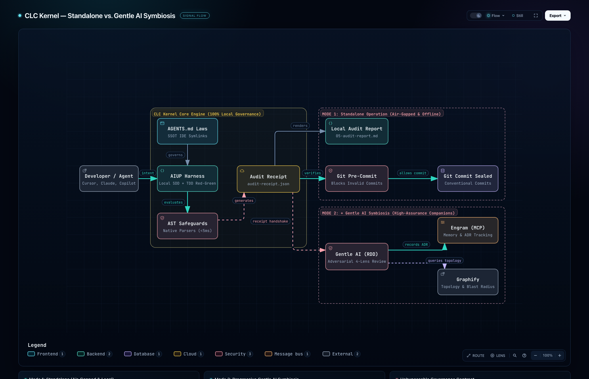
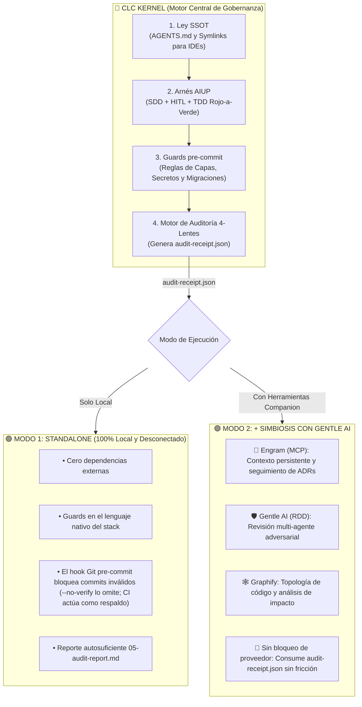

<div align="center">
  

# 🤖 CLC Kernel (`clckernel`)

[](https://www.npmjs.com/package/clckernel)
[](https://opensource.org/licenses/MIT)
[](./README.md)

**El Motor Universal de Gobernanza Determinista para Agentes de IA & Orquestador AIUP.**
*Creado por [CarlosLeonCode](https://github.com/carlosleoncode).*
</div>

Los agentes de programación con IA (Cursor, Claude Code, Windsurf, Copilot) codifican a gran velocidad, pero sin límites introducen degradación arquitectónica, tests falsos positivos y fuga de credenciales.

**CLC Kernel** es un arnés de desarrollo políglota que gobierna a los agentes mediante **guards pre-commit deterministas** (verificaciones basadas en patrones, más guards con Python AST en stacks Python), **especificaciones SDD locales** y el cumplimiento del **Proceso Unificado de IA (AIUP)**.

---

## 📋 Tabla de Contenidos
- [🎯 Casos de Uso](#-casos-de-uso)
- [🏛️ El Proceso Unificado de IA (AIUP)](#️-el-proceso-unificado-de-ia-aiup)
- [🔍 Desarrollo Guiado por Revisión (RDD) y los 4 Lentes](#-desarrollo-guiado-por-revisión-rdd-y-los-4-lentes)
- [⚡ Guía Paso a Paso (Ciclo Completo)](#-guía-paso-a-paso-ciclo-completo)
- [🎮 Interfaz Universal de Comandos](#-interfaz-universal-de-comandos)
- [🔄 Actualización de Proyectos Existentes](#-actualización-de-proyectos-existentes)
- [⚙️ Configuración (`.clckernel.yaml`)](#configuracion)
- [🌐 Ecosistemas Soportados y Arquetipos](#-ecosistemas-soportados-y-arquetipos)
- [🏛️ Arquitectura: Standalone vs. Simbiosis con Gentle AI](#-arquitectura-standalone-vs-simbiosis-con-gentle-ai)
- [🧩 Herramientas Complementarias (Opcionales)](#-herramientas-complementarias-opcionales)
- [📖 Glosario de Términos Clave](#-glosario-de-términos-clave)
- [🤝 Contribuciones y Comunidad](#-contribuciones-y-comunidad)
- [📄 Licencia](#-licencia)

---

<a id="casos-de-uso"></a>
## 🎯 Casos de Uso

| Caso de Uso | Problema que Resuelve | Cómo lo Resuelve CLC Kernel |
|---|---|---|
| **1. Gobernanza de Coding Agents**<br>*(Cursor, Claude Code, Copilot)* | Los agentes programan por intuición ("vibe coding"), se saltan pruebas y rompen capas de arquitectura en backend y frontend. | Impone la **Regla #0** (Investigación -> SDD -> TDD Rojo a Verde -> Auditoría) y bloquea commits no conformes mediante el hook pre-commit (`--no-verify` lo omite; CI actúa como respaldo). |
| **2. Arquetipos Agent-OS y Flujos de Dominio**<br>*(Bots autónomos, OS de marketing/ventas)* | Runtimes de agentes ejecutan acciones sin supervisión, alucinan métricas o desincronizan reglas en diferentes IDEs. | Provee **Gobernanza Dual-Layer** y guards para cualquier repositorio de agentes: marcadores Human-in-the-Loop explícitos en skills y playbooks (`check_hitl`), frontmatter de SKILL.md (`check_skills`), links relativos (`check_links`), placeholders olvidados (`check_placeholders`), archivos de datos JSON que parsean (`check_data_files`) y mirrors de reglas que apuntan a AGENTS.md (`check_symlinks`). Las reglas de dominio pertenecen al proyecto: los guards de `tools/guards/` se ejecutan en el hook y en el audit. |
| **3. Refactorizaciones y Migraciones Críticas** | Los agentes modifican archivos fuera del alcance acordado, introduciendo regresiones silenciosas. | Delimita el trabajo en una especificación local `sdds/{cambio}/spec.md`; el alcance es un protocolo que aplica el agente (ningún guard lo verifica). |
| **4. Blindaje Pre-Commit y Shift-Left en CI/CD** | Fuga de credenciales, consultas N+1 en bucles y migraciones destructivas llegan a ramas remotas. | Ejecuta validaciones sin dependencias foráneas en el lenguaje nativo del stack antes de cada commit: guards basados en patrones en todos los stacks y guards con Python AST (capas, heurística N+1) en stacks Python. |

---

<a id="aiup"></a>
## 🏛️ El Proceso Unificado de IA (AIUP)

```
┌─────────────────────────────────────────────────────────────────────────────┐
│                       AI UNIFIED PROCESS (AIUP)                             │
├─────────────┬─────────────┬─────────────┬──────────────────┬────────────────┤
│   1. SDD    │   2. HIT    │   3. TDD    │    4. GUARDS     │   5. MIRROR    │
│ Spec-Driven │ Human-in-the│ Transición  │ Hook pre-commit  │ Single Source  │
│ Development │    Loop     │ Rojo-a-Verde│  determinista    │ of Truth Sync  │
└─────────────┴─────────────┴─────────────┴──────────────────┴────────────────┘
```

1. **SDD (Spec-Driven Development):** El agente debe redactar una especificación técnica local gitignorada (`sdds/{feature}/spec.md`) antes de tocar código de producción.
2. **HIT (Human-in-the-Loop):** El ingeniero revisa y aprueba los contratos y escenarios de prueba antes del inicio de la implementación.
3. **TDD (Rojo a Verde):** El agente debe demostrar un test de regresión fallido (Fase Roja) antes de escribir la solución en producción (Fase Verde).
4. **Guards (Salvaguardas Deterministas):** Scripts basados en patrones (y parsers Python `ast` en stacks Python) inspeccionan el diff preparado; el hook pre-commit bloquea los commits no conformes (`--no-verify` lo omite; CI actúa como respaldo).
5. **SSOT (Única Fuente de Verdad):** `AGENTS.md` se define una sola vez y se proyecta mediante symlinks hacia `CLAUDE.md`, `GEMINI.md`, `.cursorrules` y Copilot.

---

<a id="rdd-y-lentes"></a>
## 🔍 Desarrollo Guiado por Revisión (RDD) y los 4 Lentes

CLC Kernel estructura todas sus compuertas de auditoría bajo los principios de **Review-Driven Development (RDD)**, con los resultados de los guards agrupados en **4 lentes** mediante una tabla estática nombre → lente:

```
┌─────────────────────────────────────────────────────────────────────────────┐
│                       RESULTADOS AGRUPADOS EN 4 LENTES                      │
├─────────────────────┬───────────────────┬───────────────────┬───────────────┤
│    🎯 CORRECTITUD   │    🛡️ SEGURIDAD   │  🏛️ ARQUITECTURA  │ ⚡ RENDIMIENTO│
│ Bugs funcionales,   │ Fuga de secretos, │ Violación capas,  │ Heurística N+1│
│ scope drift, TDD,   │ bypass permisos,  │ límites de dominio│ tamaño bundle,│
│ contratos API       │ eval peligroso    │ deps circulares   │ memory leaks  │
└─────────────────────┴───────────────────┴───────────────────┴───────────────┘
```

Al ejecutar `clckernel audit` (o `node tools/audit.js`), CLC Kernel genera:
1. **Informe Educativo para Humanos (`05-audit-report.md`):** Explica detalladamente qué pasó, falló o fue omitido agrupado por cada lente.
2. **Recibo Inmutable de Auditoría (`audit-receipt.json`):** Un archivo JSON inmutable y legible por máquina vinculado al `commitHash` actual que certifica el resultado para compuertas automatizadas de revisión (como Gentle AI).

---

<a id="guia-paso-a-paso"></a>
## ⚡ Guía Paso a Paso (Ciclo Completo)

```
[1. Terminal]           [2. Chat del LLM]            [3. Bucle TDD]                [4. Git Commit]
npx clckernel   ───►   clckernel start   ───►   "Feature X con harness"   ───►   Hooks Pre-commit
(Bootstrap)            (Setup Interactivo)          (SDD -> HIT -> Tests)         (Guards & Secretos)
```

### 1️⃣ Paso 1: Inicializar el Repositorio (Terminal)
```bash
npx clckernel start
```
Detecta el framework, genera `AGENTS.md`, crea symlinks dinámicos para todos los IDEs (`CLAUDE.md`, `GEMINI.md`, `.cursorrules`), provisiona hooks pre-commit e instala scripts de guards nativos en `tools/`.

### 2️⃣ Paso 2: Inicializar en el Chat del IDE (CLI Conversacional)
Abrí Cursor, Claude Code, Gemini CLI, Windsurf o Copilot y escribí:
> `clckernel start`

El agente escanea tu código en silencio, propone un plan de gobernanza adaptado a tu stack y genera `.clckernel.yaml`.

### 3️⃣ Paso 3: Desarrollar con el Arnés AIUP
Al solicitar una funcionalidad o corrección, indicá al agente:
> *"Implementa el endpoint de autenticación. **Usa el harness de CLC Kernel**."*

El agente ejecutará de forma autónoma el ciclo AIUP completo:
1. **Investigación y Causa Raíz:** Inspecciona el código base y dependencias.
2. **Especificación SDD Local:** Redacta contratos de API y planes de prueba en `sdds/{cambio}/spec.md`.
3. **Revisión HIT:** Solicita tu revisión y aprobación de los contratos propuestos.
4. **Fase Roja TDD:** Escribe un test de regresión que falle demostrando el requerimiento.
5. **Implementación Verde:** Escribe el código mínimo necesario respetando el aislamiento de capas.
6. **Compuerta de Auditoría:** Ejecuta `node tools/audit.js` y emite el resumen de verificación.

### 4️⃣ Paso 4: Verificación Determinística de Guards (Git Commit)
```bash
git add .
git commit -m "feat(auth): add user authentication endpoint"
```
Los hooks pre-commit ejecutan automáticamente los guards instalados (por ejemplo Clean Architecture, Fuga de Secretos o Reversibilidad de Migraciones, según el stack). Cualquier violación queda **bloqueada por el hook pre-commit** (`--no-verify` lo omite; CI actúa como respaldo).

El hook no enumera guards: llama a los orquestadores de auditoría (`node tools/audit.js --hook`, `python3 tools/audit.py --hook`, cada uno si está instalado) y luego a las herramientas externas del stack (linters, test runners) cuando están disponibles. Los orquestadores descubren todos los guards — los del kernel y los propios del proyecto, ya sea en la raíz de `tools/` (`check_*`, `scan_*`, `verify_*`, `*_guard`) o en `tools/guards/` — y ejecutan cada uno exactamente una vez, así que el hook de commit y `clckernel audit` siempre ejecutan el mismo conjunto.

### 5️⃣ Paso 5: Auditar la Salud del Repositorio en Cualquier Momento (Doctor)
```bash
npx clckernel doctor
```
Verifica `AGENTS.md`, `sdds/`, `tools/`, los runners de pruebas y los hooks de Git.

---

<a id="interfaz-universal-de-comandos"></a>
## 🎮 Interfaz Universal de Comandos (Todos los LLMs y Agentes)

CLC Kernel provee una gramática de comandos determinista soportada de forma nativa por **Claude Code, Cursor, Codeium/Windsurf, Copilot, Gemini y Antigravity**:

| Comando | Categoría | Protocolo de Ejecución Obligatorio |
|---|---|---|
| `clckernel feature <nombre>` | Funcionalidad | Ciclo AIUP completo: Investigación -> Spec Local (`sdds/{nombre}/spec.md`) -> Revisión HIT -> Fase Roja TDD -> Implementación Verde -> Auditoría. |
| `clckernel fix <descripción>` | Corrección | Análisis de causa raíz (sin editar código) -> Test de regresión que falle -> Corrección quirúrgica limpia -> Compuerta de auditoría. |
| `clckernel test` | Verificación | Ejecuta la suite de pruebas en el runner nativo del stack y confirma estado verde limpio. |
| `clckernel audit` | Verificación | Ejecuta `node tools/audit.js` o `python tools/audit.py` y emite el Resumen Educativo. |
| `clckernel doctor` | Diagnóstico | Valida hooks pre-commit de Git, symlinks espejo para IDEs e integridad de los scripts de guards. |
| `clckernel commit <mensaje>` | Control de Versiones | Auditoría pre-flight, verificación de scope diff vs SDD y commit con Conventional Commits (cero atribución de IA). |
| `clckernel guard create <nombre>` | Salvaguardas | Genera el scaffold de un nuevo script de guard en el lenguaje nativo del stack en `tools/guards/`; el hook de pre-commit y el audit ejecutan cada guard del proyecto (`tools/guards/*.js`/`*.py`, y los archivos `check_*`/`scan_*`/`verify_*` no gestionados en la raíz de `tools/`). |
| `clckernel update` | Mantenimiento | Actualización no destructiva: refresca herramientas core, skills y symlinks de IDEs sin sobreescribir SDDs, guards personalizados ni `.clckernel.yaml`. |
| `clckernel start` | Configuración | Detecta el stack automáticamente, propone el ciclo de vida AIUP y genera `.clckernel.yaml`. |

---

<a id="actualizacion-de-proyectos-existentes"></a>
## 🔄 Actualización de Proyectos Existentes (No Destructiva)

Cuando se publican nuevas versiones de CLC Kernel con nuevos guards, playbooks actualizados o reglas optimizadas para IDEs, podés actualizar tu repositorio de forma segura sin perder tu trabajo:

```bash
npx clckernel update
```
O directamente desde el chat de tu agente IA:
```bash
clckernel update
```

### 🔒 La Garantía de Actualización No Destructiva:
- **Refresca y Actualiza:** Orquestadores centrales (`tools/audit.js`, `tools/audit.py`), los guards nativos que tu proyecto tiene, Skills de agentes (`.agents/skills/`) y los symlinks de IDEs que tu proyecto tiene (`CLAUDE.md`, `GEMINI.md`, `.cursorrules`, Copilot, Antigravity).
- **100% Preservado:**
  - `sdds/`: Todas las especificaciones locales, planes y recibos de verificación permanecen intactos.
  - Los guards del proyecto (`tools/guards/`, y los archivos de guard en la raíz de `tools/` que el kernel no gestiona) se conservan sin modificaciones. Un guard del kernel que el kernel ya no distribuye queda exactamente donde está, sale del registro y sigue ejecutándose como guard del proyecto; `update` lo informa como "retired kernel guard kept as project guard".
  - `.clckernel.yaml`: nunca se reescribe; update lo lee (ver [Configuración](#configuracion)).
  - El código fuente de la aplicación y modelos de dominio jamás se tocan.

### 🛡️ Los archivos que editaste nunca se sobrescriben
`update` (y una reinstalación con `--yes`) sólo sobrescribe un archivo del kernel (`tools/*`, el hook de
pre-commit, la skill `clckernel_cli`) cuando puede probar que es suyo y está intacto: su sha256 coincide con el
del registro (`tools/.clckernel-managed.json`) o con una versión que el kernel publicó. Todo lo demás — un guard
que endureciste, un archivo del proyecto que comparte nombre con uno del kernel — se conserva byte a byte, y la
versión nueva se escribe al lado como `<archivo>.clckernel-new` (ignorado por git) para que la revises y
fusiones. El resumen lista lo escrito, sin cambios, protegido, movido, agregado a `.gitignore` y configurado en
`git config`.

Previsualizá primero con `--dry-run`: imprime el mismo resumen como plan y no escribe nada (ni archivos, ni
`.gitignore`, ni `git config`):
```bash
npx clckernel update . --dry-run
npx clckernel . --yes --dry-run
```

### ➕ `update` nunca agrega lo que no elegiste
`update` actualiza lo que el proyecto ya tiene; nunca agrega guards ni mirrors de IDE por su cuenta:
- **Guards:** sólo se actualizan (y corre el hook) los guards del registro o presentes en `tools/`. Los
  guards nuevos de tu stack se listan como *available, not installed*; se agregan con `--add-guards` (desde
  ahí quedan instalados y se actualizan). Un nombre desconocido falla con exit 1 y no escribe nada. Los
  archivos de soporte (`_changes.js/.py`, los lectores de config `_config.js/.py`, `yaml.js`, `_yaml.py`, los
  orquestadores de audit) siguen a los guards instalados.
- **Mirrors:** un mirror que borraste (p. ej. `.cursor/rules/clckernel_context.mdc`) no se recrea; se reporta
  como *not present (skipped)*. Una instalación nueva los sigue creando todos.
- **`.gitignore`:** una entrada cuya ruta git trackea (un mirror o la skill que commiteás) nunca se agrega, ni
  en install ni en update; se reporta como *tracked, not ignored*.
```bash
npx clckernel update . --add-guards check_skills,check_placeholders
npx clckernel update . --add-guards all
```

---

<a id="configuracion"></a>
## ⚙️ Configuración (`.clckernel.yaml`)

Opcional. Sin el archivo rige cada valor por defecto de abajo (el comportamiento de un proyecto sin
config). Install, update y cada guard lo leen desde la raíz del proyecto; un valor inválido los detiene
con `Invalid .clckernel.yaml: key "<key>" — <motivo>` (no se escribe nada, el commit se bloquea).

| Clave | Efecto | Por defecto | La lee |
|---|---|---|---|
| `rules` | Reglas regex propias (`name`, `pattern`, `message`, opcionales `severity`, `scope`, `exclude`) sobre los archivos cambiados | ninguna | `check_custom` |
| `exclude_paths` | Globs que ningún guard basado en el diff evalúa (secretos, verificador TDD, reglas propias, …) | ninguno | `_changes.js/.py` |
| `mirrors.list` | Mirrors de IDE (symlinks a `AGENTS.md`) que install crea y `check_symlinks` verifica | install: `CLAUDE.md`, `GEMINI.md`, `.cursorrules`, `.cursor/rules/clckernel_context.mdc`, `.github/copilot-instructions.md`, `.antigravity/rules.md`; `check_symlinks`: `CLAUDE.md`, `GEMINI.md`, `.cursorrules`, `.windsurfrules` | install/update, `check_symlinks` |
| `mirrors.required` | `true`: un mirror listado que falta hace fallar `check_symlinks` | `false` | `check_symlinks` |
| `hitl.markers` | Regex (sin distinguir mayúsculas, una línea, fuera de bloques de código) que cuentan como marcador Human-in-the-Loop; reemplazan a los de por defecto | una línea `HITL:` o un encabezado `## Human checkpoint` / `## HITL` | `check_hitl` |
| `hitl.paths` | Globs de los archivos cambiados que evalúa `check_hitl` | skills (`SKILL.md`, `skills/*.md` planos) y `playbooks/**/*.md` | `check_hitl` |
| `hitl.optOut` | `{ key, value }`: un archivo cuyo frontmatter tiene `key: value` queda exento | ninguno | `check_hitl` |
| `update.exclude` | Globs relativos a la raíz que install y update nunca escriben, mueven ni borran; se listan como *excluded by config* | ninguno | install/update |
| `tdd.code` | Globs extra que cuentan como código de producción (cualquier lenguaje), p. ej. tools en Python testeadas con tests JS | ninguno | `verify_tdd.js/.py` |
| `tdd.ignore` | Globs que nunca cuentan como código de producción | ninguno | `verify_tdd.js/.py` |

```yaml
exclude_paths: ["vendor/**"]
mirrors:
  list: [CLAUDE.md, .github/copilot-instructions.md]
  required: true
hitl:
  optOut: { key: checkpoint, value: none }
update:
  exclude: [AGENTS.md]
tdd:
  code: ["tools/**/*.py"]
```

Las claves que versiones anteriores aceptaban sin efecto alguno — `active_guards`, `phases`, `gate_mode`,
`severities`, `layers`, `scope` — se ignoran con un aviso de deprecación; borralas. Una clave desconocida de
primer nivel se ignora con un aviso. Los guards lo leen con `tools/_config.js` (+ `yaml.js`) y
`tools/_config.py` (+ `_yaml.py`), instalados junto a `_changes.js/.py`, así que un archivo creado después de
instalar aplica de inmediato.

---

<a id="ecosistemas-soportados"></a>
## 🌐 Ecosistemas Soportados y Arquetipos

| Ecosistema | Firma de Detección | Test Runner | Salvaguardas Nativas |
|---|---|---|---|
| ⚛️ **Next.js** | `next` | Vitest / Jest | Clean Architecture, Reutilización de UI, Tokens Semánticos, RSC, A11y, Responsive, SEO |
| ⚡ **FastAPI** | `fastapi` | Pytest | Reversibilidad de Migraciones Alembic, Clean Architecture (Python AST), Heurística N+1 (Python AST), Verificador TDD Rojo→Verde (pytest) |
| 💎 **Rails** | `Gemfile` | RSpec | RuboCop, Seguridad Brakeman |
| 🐹 **Golang** | `go.mod` | `go test` | `golangci-lint`, Aislamiento de Capas Dominio/Casos de Uso |
| 🦀 **Rust** | `Cargo.toml` | `cargo test` | `cargo clippy`, `cargo audit`, Seguridad Estricta de Memoria |
| 🐘 **Laravel** | `artisan` | Pest / PHPUnit | Análisis estático PHPStan |
| 🎸 **Django** | `manage.py` | `pytest-django` | Ruff, Clean Architecture (Python AST), Heurística N+1 (Python AST), Verificador TDD Rojo→Verde (pytest) |
| 🚀 **Astro** | `astro.config` | Playwright | Tokens Tailwind v4, Esquemas de Colección, A11y, Responsive, SEO |
| 🤖 **Agent-OS** | `skills/<nombre>/SKILL.md` (también `.agents/skills/`, `.claude/skills/`), `playbooks/` o `rules/` con Markdown; si el repo también tiene un stack de código, gana el stack de código | Tests de Contrato | AGENTS.md Dual-Layer, marcadores HITL (`check_hitl`), Skills (`check_skills`), Links (`check_links`), Placeholders (`check_placeholders`), Datos JSON (`check_data_files`), Mirrors (`check_symlinks`), Reglas propias (`check_custom`); guards del proyecto en `tools/guards/` |

### 🧱 Full-stack y monorepos

Un repositorio puede tener varias partes de código. `clckernel` busca un stack en la raíz, en los directorios
declarados como workspaces (`package.json#workspaces`, como lista o `{ packages }`, y `packages:` de
`pnpm-workspace.yaml`) y en los directorios convencionales `frontend`, `backend`, `web`, `api`, `server`,
`client`, `apps/*`, `services/*` y `packages/*` (hasta dos niveles; se omiten `node_modules`, `.git`,
`vendor`, `dist` y `build`). Los patrones de workspace se interpretan como directorios literales o `dir/*`;
otras formas de glob se ignoran.

- **Una parte en la raíz:** se instala exactamente igual que un repositorio de un solo stack.
- **Varias partes** (p. ej. Next.js en la raíz + `backend/` FastAPI, o `apps/web` + `apps/api`): el tipo de
  proyecto es `fullstack` (hay una parte en la raíz) o `monorepo` (solo subdirectorios). Dos stacks del mismo
  ecosistema en un directorio (p. ej. FastAPI y Django) siguen siendo una parte, y gana el primer adapter,
  como antes.
- **Guards:** la unión de los guards de las partes se instala una vez en `tools/` de la raíz, con un
  orquestador de auditoría por lenguaje, y se ejecuta una vez desde la raíz.
- **Herramientas externas** (ruff, pytest, tsc, …) se ejecutan dentro del directorio de su parte; si una no
  está disponible se imprime `clckernel: <herramienta> (<dir>) not available, skipped`.
- **Verificador TDD Rojo→Verde:** cada archivo cambiado pertenece a su raíz de proyecto más cercana (Python:
  `pyproject.toml`, `requirements.txt`, `setup.cfg`, `setup.py`, `manage.py`; JS: `package.json`). Cada grupo
  se ejecuta en su raíz (`PYTHONPATH`, runner y `node_modules` de esa raíz, o los `node_modules` de la raíz
  del repositorio si están elevados). El código cambiado en una parte sin un test cambiado en esa misma parte
  falla.
- **AGENTS.md** lista cada parte (directorio, stack, test runner) con las reglas de su stack; `clckernel
  update` vuelve a detectar las partes.

Fuera de alcance: Agent-OS como parte de un monorepo, repositorios git anidados o submódulos, elegir partes
manualmente en el prompt interactivo ("Elegir otro stack" instala un solo stack) y los workspaces de
Go/Cargo/Composer (sus partes solo se detectan por los directorios convencionales).

---

<a id="arquitectura-simbiosis"></a>
## 🏛️ Arquitectura: Standalone vs. Simbiosis con Gentle AI

CLC Kernel está diseñado bajo una **filosofía de cero dependencias forzadas**: opera como un motor de gobernanza 100% autosuficiente y local, ofreciendo a su vez interoperabilidad nativa y fluida con el ecosistema de [Gentle AI](https://github.com/Gentleman-Programming/gentle-ai).

<div align="center">
  
</div>

> 💡 *Diagrama Interactivo: Generado con [Archify](https://github.com/tt-a1i/archify). Podés abrir [`docs/Architecture/clckernel-symbiosis.html`](./docs/Architecture/clckernel-symbiosis.html) para explorar la animación de flujo, cambiar entre modo claro/oscuro e inspeccionar detalles de cada nodo.*



---

<a id="herramientas-complementarias"></a>
## 🧩 Herramientas Complementarias (Opcionales)

CLC Kernel se enfoca estrictamente en gobernanza y opera con **cero dependencias foráneas**. Se integra de forma modular con:
- 🧠 **[Engram (MCP)](https://github.com/Gentleman-Programming/gentle-ai):** Memoria arquitectónica persistente y registro de ADRs entre sesiones.
- 🕸️ **[Graphify](https://github.com/carlosleoncode/graphify):** Generación de grafos visuales de dependencias y topología del código.
- 🛡️ **[Gentle AI (RDD)](https://github.com/Gentleman-Programming/gentle-ai):** Compuerta de revisión multi-lente adversaria antes de commitear.

---

<a id="glosario"></a>
## 📖 Glosario de Términos Clave

| Término | Definición |
|---|---|
| **SDD** *(Spec-Driven Development)* | Metodología orientada a especificaciones previas donde los contratos técnicos, esquemas, criterios de aceptación y escenarios de prueba se redactan en specs locales gitignoradas (`sdds/{cambio}/spec.md`) antes de modificar código fuente. |
| **RDD** *(Review-Driven Development)* | Metodología de verificación adversarial y estructurada donde los cambios se auditan a través de cuatro lentes ortogonales (Correctitud, Seguridad, Arquitectura y Rendimiento) para garantizar compuertas sistemáticas de calidad antes del merge o commit. |
| **AIUP** *(AI Unified Process)* | El ciclo de vida gobernado de punta a punta implementado por CLC Kernel: Investigación $\rightarrow$ SDD local $\rightarrow$ Aprobación Human-in-the-Loop (HITL) $\rightarrow$ TDD Rojo a Verde $\rightarrow$ Compuerta de Auditoría de Guards $\rightarrow$ Conventional Commit. |
| **HIT / HITL** *(Human-in-the-Loop)* | Compuerta obligatoria de aprobación donde un ingeniero humano valida contratos, decisiones arquitectónicas y pruebas propuestas antes de que un agente autónomo edite código de producción. |
| **TDD** *(Test-Driven Development)* | Práctica de ingeniería de reproducir bugs o especificar nuevas funcionalidades mediante un test automatizado que falle (Fase Roja) antes de escribir el código mínimo de producción para que pase (Fase Verde). |
| **Guard** *(Script de salvaguarda)* | Verificación liviana sin dependencias foráneas escrita en el lenguaje nativo del stack y ejecutada por el hook pre-commit. La mayoría de los guards se basan en patrones (regex); en stacks Python, los guards de capas, N+1 y Celery/Redis/Postgres analizan el código con Python `ast`. El hook bloquea las violaciones antes del commit (`--no-verify` lo omite; CI actúa como respaldo). |
| **SSOT** *(Single Source of Truth / Única Fuente de Verdad)* | Principio de gobernanza centralizada donde `AGENTS.md` funciona como la ley única, proyectándose automáticamente a todos los entornos de agentes (`CLAUDE.md`, `GEMINI.md`, `.cursorrules`, Copilot) mediante symlinks del sistema de archivos. |
| **Recibo de Auditoría** *(Audit Receipt)* | Artefacto JSON inmutable y legible por máquina (`audit-receipt.json`) producido por el motor de auditoría con la marca de tiempo, hash del commit, veredictos por cada lente y metadatos de compatibilidad RDD para Gentle AI. |
| **ADR** *(Architectural Decision Record)* | Documento estandarizado bajo `docs/Journal/` que captura decisiones arquitectónicas clave, contexto histórico, alternativas evaluadas y consecuencias. |
| **Agent-OS** | Arquetipo de sistema operativo para flujos de agentes y dominios no técnicos (por ejemplo: Marketing OS, Content Ops, Research OS) compuesto por skills, playbooks, reglas, prompts y templates, gobernado por un AGENTS.md de dos capas, checkpoints HITL explícitos y guards de documentos (frontmatter de skills, links, placeholders). |

---

## 🤝 Contribuciones y Comunidad
Las contribuciones son bienvenidas. Consulte estos documentos (en inglés):

- [CONTRIBUTING.md](CONTRIBUTING.md) — configuración, el hook pre-commit, las pruebas y el flujo de pull requests.
- [CODE_OF_CONDUCT.md](CODE_OF_CONDUCT.md) — conducta esperada y cómo reportar un problema.
- [SECURITY.md](SECURITY.md) — cómo reportar una vulnerabilidad de forma privada.
- [CHANGELOG.md](CHANGELOG.md) — cambios relevantes de cada versión.

<a id="licencia"></a>
## 📄 Licencia
MIT © [CarlosLeonCode](https://github.com/carlosleoncode) — consulte [LICENSE](LICENSE).
