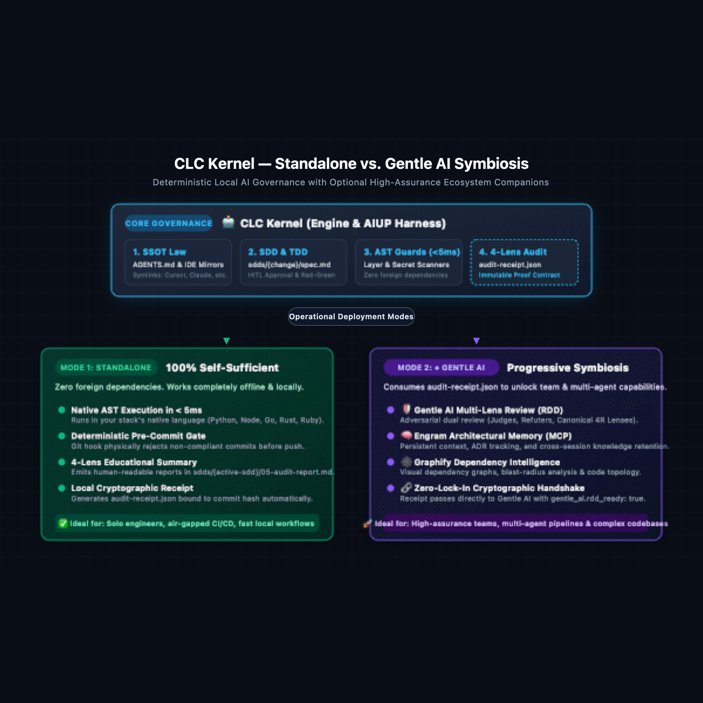
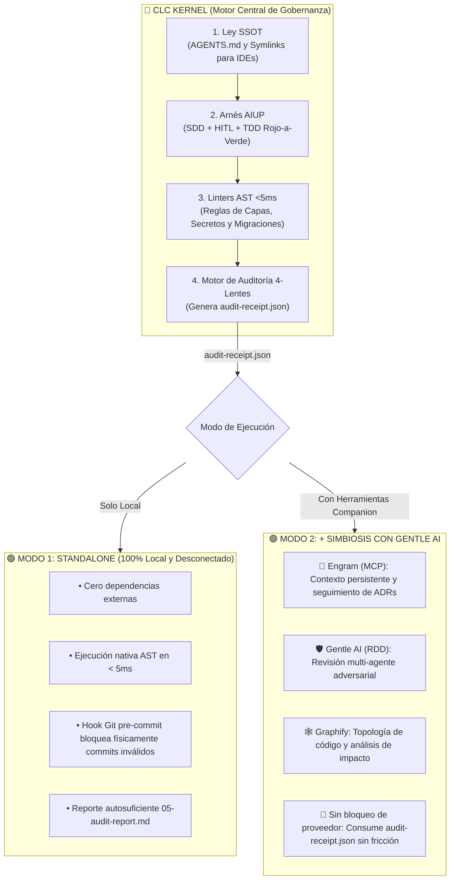

<div align="center">
  

# 🤖 CLC Kernel (`clckernel`)

[](https://www.npmjs.com/package/clckernel)
[](https://opensource.org/licenses/MIT)
[](./README.md)

**El Motor Universal de Gobernanza Determinista para Agentes de IA & Orquestador AIUP.**
*Creado por [CarlosLeonCode](https://github.com/carlosleoncode).*
</div>

Los agentes de programación con IA (Cursor, Claude Code, Windsurf, Copilot) codifican a gran velocidad, pero sin límites introducen degradación arquitectónica, tests falsos positivos y fuga de credenciales.

**CLC Kernel** es un arnés de desarrollo políglota que gobierna físicamente a los agentes mediante **linters AST deterministas (< 5ms)**, **especificaciones SDD locales** y el cumplimiento del **Proceso Unificado de IA (AIUP)**.

---

## 📋 Tabla de Contenidos
- [🎯 Casos de Uso](#-casos-de-uso)
- [🏛️ El Proceso Unificado de IA (AIUP)](#️-el-proceso-unificado-de-ia-aiup)
- [🔍 Desarrollo Guiado por Revisión (RDD) y los 4 Lentes](#-desarrollo-guiado-por-revisión-rdd-y-los-4-lentes)
- [⚡ Guía Paso a Paso (Ciclo Completo)](#-guía-paso-a-paso-ciclo-completo)
- [🎮 Interfaz Universal de Comandos](#-interfaz-universal-de-comandos)
- [🔄 Actualización de Proyectos Existentes](#-actualización-de-proyectos-existentes)
- [🌐 Ecosistemas Soportados y Arquetipos](#-ecosistemas-soportados-y-arquetipos)
- [🏛️ Arquitectura: Standalone vs. Simbiosis con Gentle AI](#-arquitectura-standalone-vs-simbiosis-con-gentle-ai)
- [🧩 Herramientas Complementarias (Opcionales)](#-herramientas-complementarias-opcionales)
- [📖 Glosario de Términos Clave](#-glosario-de-términos-clave)
- [📄 Licencia](#-licencia)

---

<a id="casos-de-uso"></a>
## 🎯 Casos de Uso

| Caso de Uso | Problema que Resuelve | Cómo lo Resuelve CLC Kernel |
|---|---|---|
| **1. Gobernanza de Coding Agents**<br>*(Cursor, Claude Code, Copilot)* | Los agentes programan por intuición ("vibe coding"), se saltan pruebas y rompen capas de arquitectura en backend y frontend. | Impone la **Regla #0** (Investigación -> SDD -> TDD Rojo a Verde -> Auditoría AST) y bloquea commits no conformes mediante linters AST. |
| **2. Arquetipos Agent-OS y Flujos de Dominio**<br>*(Bots autónomos, OS de marketing/ventas)* | Runtimes de agentes ejecutan acciones sin supervisión, alucinan métricas o desincronizan reglas en diferentes IDEs. | Provee **Gobernanza Dual-Layer**, valida symlinks de reglas para IDEs, exige compuertas Human-in-the-Loop (`check_hitl`) y valida esquemas con null seguro (`check_domain_data`). |
| **3. Refactorizaciones y Migraciones Críticas** | Los agentes modifican archivos fuera del alcance acordado, introduciendo regresiones silenciosas. | Delimita el trabajo en una especificación local `sdds/{cambio}/spec.md` y bloquea commits que toquen archivos no autorizados (`check_scope`). |
| **4. Blindaje Pre-Commit y Shift-Left en CI/CD** | Fuga de credenciales, consultas N+1 en bucles y migraciones destructivas llegan a ramas remotas. | Ejecuta validaciones AST sin dependencias foráneas en el lenguaje nativo del stack en **< 5ms** antes de cada commit. |

---

<a id="aiup"></a>
## 🏛️ El Proceso Unificado de IA (AIUP)

```
┌─────────────────────────────────────────────────────────────────────────────┐
│                       AI UNIFIED PROCESS (AIUP)                             │
├─────────────┬─────────────┬─────────────┬──────────────────┬────────────────┤
│   1. SDD    │   2. HIT    │   3. TDD    │     4. AST       │   5. MIRROR    │
│ Spec-Driven │ Human-in-the│ Transición  │ Linters de Capas │ Single Source  │
│ Development │    Loop     │ Rojo-a-Verde│  Determinísticos │ of Truth Sync  │
└─────────────┴─────────────┴─────────────┴──────────────────┴────────────────┘
```

1. **SDD (Spec-Driven Development):** El agente debe redactar una especificación técnica local gitignorada (`sdds/{feature}/spec.md`) antes de tocar código de producción.
2. **HIT (Human-in-the-Loop):** El ingeniero revisa y aprueba los contratos y escenarios de prueba antes del inicio de la implementación.
3. **TDD (Rojo a Verde):** El agente debe demostrar un test de regresión fallido (Fase Roja) antes de escribir la solución en producción (Fase Verde).
4. **AST (Salvaguardas Deterministas):** Parsers nativos del stack (Python `ast`, Go `ast`, RuboCop, TypeScript AST) inspeccionan el diff y bloquean físicamente commits no conformes.
5. **SSOT (Única Fuente de Verdad):** `AGENTS.md` se define una sola vez y se proyecta mediante symlinks hacia `CLAUDE.md`, `GEMINI.md`, `.cursorrules` y Copilot.

---

<a id="rdd-y-lentes"></a>
## 🔍 Desarrollo Guiado por Revisión (RDD) y los 4 Lentes

CLC Kernel estructura todas sus compuertas de auditoría bajo los principios de **Review-Driven Development (RDD)**, organizando cada salvaguarda en torno a los **4 Lentes Canónicos de Revisión**:

```
┌─────────────────────────────────────────────────────────────────────────────┐
│                       LOS 4 LENTES CANÓNICOS DE REVISIÓN                    │
├─────────────────────┬───────────────────┬───────────────────┬───────────────┤
│    🎯 CORRECTITUD   │    🛡️ SEGURIDAD   │  🏛️ ARQUITECTURA  │ ⚡ RENDIMIENTO│
│ Bugs funcionales,   │ Fuga de secretos, │ Violación capas,  │ N+1 queries,  │
│ scope drift, TDD,   │ bypass permisos,  │ límites de dominio│ tamaño bundle,│
│ contratos API       │ eval peligroso    │ deps circulares   │ memory leaks  │
└─────────────────────┴───────────────────┴───────────────────┴───────────────┘
```

Al ejecutar `clckernel audit` (o `node tools/audit.js`), CLC Kernel genera:
1. **Informe Educativo para Humanos (`05-audit-report.md`):** Explica detalladamente qué pasó, falló o fue omitido agrupado por cada lente.
2. **Recibo Inmutable de Auditoría (`audit-receipt.json`):** Un archivo JSON inmutable y legible por máquina vinculado al `commitHash` actual que certifica el resultado para compuertas automatizadas de revisión (como Gentle AI).

---

<a id="guia-paso-a-paso"></a>
## ⚡ Guía Paso a Paso (Ciclo Completo)

```
[1. Terminal]           [2. Chat del LLM]            [3. Bucle TDD]                [4. Git Commit]
npx clckernel   ───►   clckernel start   ───►   "Feature X con harness"   ───►   Hooks Pre-commit
(Bootstrap)            (Setup Interactivo)          (SDD -> HIT -> Tests)         (Guardián AST & Secretos)
```

### 1️⃣ Paso 1: Inicializar el Repositorio (Terminal)
```bash
npx clckernel start
```
Detecta el framework, genera `AGENTS.md`, crea symlinks dinámicos para todos los IDEs (`CLAUDE.md`, `GEMINI.md`, `.cursorrules`), provisiona hooks pre-commit e instala verificadores AST en `tools/`.

### 2️⃣ Paso 2: Inicializar en el Chat del IDE (CLI Conversacional)
Abrí Cursor, Claude Code, Gemini CLI, Windsurf o Copilot y escribí:
> `clckernel start`

El agente escanea tu código en silencio, propone un plan de gobernanza adaptado a tu stack y genera `.clckernel.yaml`.

### 3️⃣ Paso 3: Desarrollar con el Arnés AIUP
Al solicitar una funcionalidad o corrección, indicá al agente:
> *"Implementa el endpoint de autenticación. **Usa el harness de CLC Kernel**."*

El agente ejecutará de forma autónoma el ciclo AIUP completo:
1. **Investigación y Causa Raíz:** Inspecciona el código base y dependencias.
2. **Especificación SDD Local:** Redacta contratos de API y planes de prueba en `sdds/{cambio}/spec.md`.
3. **Revisión HIT:** Solicita tu revisión y aprobación de los contratos propuestos.
4. **Fase Roja TDD:** Escribe un test de regresión que falle demostrando el requerimiento.
5. **Implementación Verde:** Escribe el código mínimo necesario respetando el aislamiento de capas.
6. **Compuerta de Auditoría AST:** Ejecuta `node tools/audit.js` y emite el resumen de verificación.

### 4️⃣ Paso 4: Verificación Determinística de Guards (Git Commit)
```bash
git add .
git commit -m "feat(auth): add user authentication endpoint"
```
Los hooks pre-commit ejecutan automáticamente los escáneres AST (Clean Architecture, Fuga de Secretos, Scope Guard, Idempotencia de Migraciones). Cualquier violación **bloquea físicamente** el commit.

### 5️⃣ Paso 5: Auditar la Salud del Repositorio en Cualquier Momento (Doctor)
```bash
npx clckernel doctor
```
Audita el 100% de cumplimiento en `AGENTS.md`, `sdds/`, `tools/`, runners de pruebas activos y hooks de Git.

---

<a id="interfaz-universal-de-comandos"></a>
## 🎮 Interfaz Universal de Comandos (Todos los LLMs y Agentes)

CLC Kernel provee una gramática de comandos determinista soportada de forma nativa por **Claude Code, Cursor, Codeium/Windsurf, Copilot, Gemini y Antigravity**:

| Comando | Categoría | Protocolo de Ejecución Obligatorio |
|---|---|---|
| `clckernel feature <nombre>` | Funcionalidad | Ciclo AIUP completo: Investigación -> Spec Local (`sdds/{nombre}/spec.md`) -> Revisión HIT -> Fase Roja TDD -> Implementación Verde -> Auditoría. |
| `clckernel fix <descripción>` | Corrección | Análisis de causa raíz (sin editar código) -> Test de regresión que falle -> Corrección quirúrgica limpia -> Compuerta de auditoría. |
| `clckernel test` | Verificación | Ejecuta la suite de pruebas en el runner nativo del stack y confirma estado verde limpio. |
| `clckernel audit` | Verificación | Ejecuta `node tools/audit.js` o `python tools/audit.py` y emite el Resumen Educativo. |
| `clckernel doctor` | Diagnóstico | Valida hooks pre-commit de Git, symlinks espejo para IDEs e integridad del motor AST. |
| `clckernel commit <mensaje>` | Control de Versiones | Auditoría pre-flight, verificación de scope diff vs SDD y commit con Conventional Commits (cero atribución de IA). |
| `clckernel guard create <nombre>` | Salvaguardas | Genera el scaffold de un nuevo script de guard AST en el lenguaje nativo del stack en `tools/guards/`. |
| `clckernel update` | Mantenimiento | Actualización no destructiva: refresca herramientas core, skills y symlinks de IDEs sin sobreescribir SDDs, guards personalizados ni `.clckernel.yaml`. |
| `clckernel start` | Configuración | Detecta el stack automáticamente, propone el ciclo de vida AIUP y genera `.clckernel.yaml`. |

---

<a id="actualizacion-de-proyectos-existentes"></a>
## 🔄 Actualización de Proyectos Existentes (No Destructiva)

Cuando se publican nuevas versiones de CLC Kernel con nuevos guards AST, playbooks actualizados o reglas optimizadas para IDEs, podés actualizar tu repositorio de forma segura sin perder tu trabajo:

```bash
npx clckernel update
```
O directamente desde el chat de tu agente IA:
```bash
clckernel update
```

### 🔒 La Garantía de Actualización No Destructiva:
- **Refresca y Actualiza:** Orquestadores centrales (`tools/audit.js`, `tools/audit.py`), guards AST nativos, Skills de agentes (`.agents/skills/`) y symlinks de IDEs (`CLAUDE.md`, `GEMINI.md`, `.cursorrules`, Copilot, Antigravity).
- **100% Preservado:**
  - `sdds/`: Todas las especificaciones locales, planes y recibos de verificación permanecen intactos.
  - `tools/guards/`: Todos los guards AST personalizados creados por el equipo se conservan sin modificaciones.
  - `.clckernel.yaml`: Todas las configuraciones y umbrales personalizados se mantienen.
  - El código fuente de la aplicación y modelos de dominio jamás se tocan.

---

<a id="ecosistemas-soportados"></a>
## 🌐 Ecosistemas Soportados y Arquetipos

| Ecosistema | Firma de Detección | Test Runner | Salvaguardas Nativas |
|---|---|---|---|
| ⚛️ **Next.js** | `next` | Vitest / Jest | Clean Architecture, Reutilización de UI, Tokens Semánticos, RSC, A11y, Responsive, SEO |
| ⚡ **FastAPI** | `fastapi` | Pytest | Pydantic V2, Idempotencia Alembic, AST Clean Architecture, Eficiencia DB (N+1) |
| 💎 **Rails** | `Gemfile` | RSpec | AST RuboCop, Seguridad Brakeman, Idempotencia de Migraciones |
| 🐹 **Golang** | `go.mod` | `go test` | AST `golangci-lint`, Aislamiento de Capas Dominio/Casos de Uso |
| 🦀 **Rust** | `Cargo.toml` | `cargo test` | AST `cargo clippy`, `cargo audit`, Seguridad Estricta de Memoria |
| 🐘 **Laravel** | `artisan` | Pest / PHPUnit | AST PHPStan, Detección de Consultas N+1 en Eloquent, Migraciones |
| 🎸 **Django** | `manage.py` | `pytest-django` | Idempotencia ORM Django, AST Ruff, Scope Guard, Eficiencia DB (N+1) |
| 🚀 **Astro** | `astro.config` | Playwright | Tokens Tailwind v4, Esquemas de Colección, A11y, Responsive, SEO |
| 🤖 **Agent-OS** | `skills/`, `brand/`, `templates/` | Tests de Contrato | AGENTS.md Dual-Layer, Compuertas HITL (`check_hitl`), Symlinks (`check_symlinks`), Integridad de Datos (`check_domain_data`) |

---

<a id="arquitectura-simbiosis"></a>
## 🏛️ Arquitectura: Standalone vs. Simbiosis con Gentle AI

CLC Kernel está diseñado bajo una **filosofía de cero dependencias forzadas**: opera como un motor de gobernanza 100% autosuficiente y local, ofreciendo a su vez interoperabilidad nativa y fluida con el ecosistema de [Gentle AI](https://github.com/Gentleman-Programming/gentle-ai).

<div align="center">
  
</div>



---

<a id="herramientas-complementarias"></a>
## 🧩 Herramientas Complementarias (Opcionales)

CLC Kernel se enfoca estrictamente en gobernanza y opera con **cero dependencias foráneas**. Se integra de forma modular con:
- 🧠 **[Engram (MCP)](https://github.com/Gentleman-Programming/gentle-ai):** Memoria arquitectónica persistente y registro de ADRs entre sesiones.
- 🕸️ **[Graphify](https://github.com/carlosleoncode/graphify):** Generación de grafos visuales de dependencias y topología del código.
- 🛡️ **[Gentle AI (RDD)](https://github.com/Gentleman-Programming/gentle-ai):** Compuerta de revisión multi-lente adversaria antes de commitear.

---

<a id="glosario"></a>
## 📖 Glosario de Términos Clave

| Término | Definición |
|---|---|
| **SDD** *(Spec-Driven Development)* | Metodología orientada a especificaciones previas donde los contratos técnicos, esquemas, criterios de aceptación y escenarios de prueba se redactan en specs locales gitignoradas (`sdds/{cambio}/spec.md`) antes de modificar código fuente. |
| **RDD** *(Review-Driven Development)* | Metodología de verificación adversarial y estructurada donde los cambios se auditan a través de cuatro lentes ortogonales (Correctitud, Seguridad, Arquitectura y Rendimiento) para garantizar compuertas sistemáticas de calidad antes del merge o commit. |
| **AIUP** *(AI Unified Process)* | El ciclo de vida gobernado de punta a punta implementado por CLC Kernel: Investigación $\rightarrow$ SDD local $\rightarrow$ Aprobación Human-in-the-Loop (HITL) $\rightarrow$ TDD Rojo a Verde $\rightarrow$ Compuerta de Auditoría AST $\rightarrow$ Conventional Commit. |
| **HIT / HITL** *(Human-in-the-Loop)* | Compuerta obligatoria de aprobación donde un ingeniero humano valida contratos, decisiones arquitectónicas y pruebas propuestas antes de que un agente autónomo edite código de producción. |
| **TDD** *(Test-Driven Development)* | Práctica de ingeniería de reproducir bugs o especificar nuevas funcionalidades mediante un test automatizado que falle (Fase Roja) antes de escribir el código mínimo de producción para que pase (Fase Verde). |
| **Guard AST** *(Salvaguarda de Árbol de Sintaxis Abstracta)* | Script liviano de análisis estático sin dependencias foráneas escrito en el lenguaje nativo del stack (Python `ast`, TypeScript Compiler API, Go `go/parser`, RuboCop, etc.) que se ejecuta en menos de 5ms para bloquear físicamente violaciones antes del commit. |
| **SSOT** *(Single Source of Truth / Única Fuente de Verdad)* | Principio de gobernanza centralizada donde `AGENTS.md` funciona como la ley única, proyectándose automáticamente a todos los entornos de agentes (`CLAUDE.md`, `GEMINI.md`, `.cursorrules`, Copilot) mediante symlinks del sistema de archivos. |
| **Recibo de Auditoría** *(Audit Receipt)* | Artefacto JSON inmutable y legible por máquina (`audit-receipt.json`) producido por el motor de auditoría con la marca de tiempo, hash del commit, veredictos por cada lente y metadatos de compatibilidad RDD para Gentle AI. |
| **ADR** *(Architectural Decision Record)* | Documento estandarizado bajo `docs/Journal/` que captura decisiones arquitectónicas clave, contexto histórico, alternativas evaluadas y consecuencias. |
| **Agent-OS** | Arquetipo de sistema operativo para flujos de agentes y dominios no técnicos (por ejemplo: Marketing OS, Content Ops, Research OS) gobernado por arquitectura de dos capas, validación estricta de esquemas y compuertas HITL. |

---

<a id="licencia"></a>
## 📄 Licencia
MIT © [CarlosLeonCode](https://github.com/carlosleoncode)
