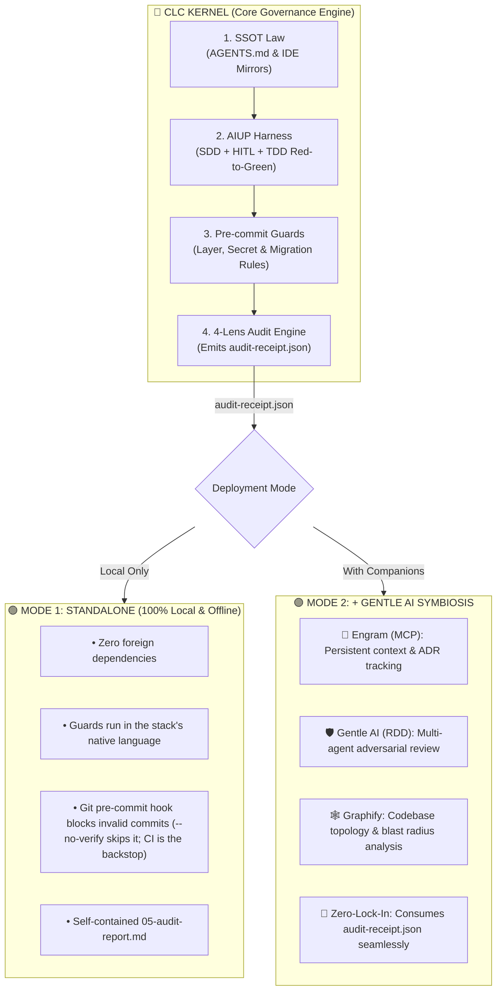

<div align="center">
  

# 🤖 CLC Kernel (`clckernel`)

[](https://www.npmjs.com/package/clckernel)
[](https://opensource.org/licenses/MIT)
[](./README.es.md)

**Deterministic AI Agent Governance Engine & AIUP Orchestrator.**
*Forged by [CarlosLeonCode](https://github.com/carlosleoncode).*
</div>

AI coding agents (Cursor, Claude Code, Windsurf, Copilot) code fast, but without guardrails they create architectural decay, tautological tests, and secret leaks. 

**CLC Kernel** is a polyglot developer harness that governs AI agents using **deterministic pre-commit guards** (pattern-based checks, plus Python AST guards on Python stacks), **local SDD specs**, and an enforced **AI Unified Process (AIUP)**.

---

## 📋 Table of Contents
- [🎯 Use Cases](#-use-cases)
- [🏛️ The AI Unified Process (AIUP)](#️-the-ai-unified-process-aiup)
- [🔍 Review-Driven Development (RDD) & the 4 Lenses](#-review-driven-development-rdd--the-4-lenses)
- [⚡ Step-by-Step Guide (Full Lifecycle)](#-step-by-step-guide-full-lifecycle)
- [🎮 Universal Command Interface](#-universal-command-interface)
- [🔄 Updating an Existing Project](#-updating-an-existing-project)
- [⚙️ Configuration (`.clckernel.yaml`)](#configuration)
- [🌐 Supported Stacks & Archetypes](#-supported-stacks--archetypes)
- [⚠️ Known limitations](#known-limitations)
- [🏛️ Architecture: Standalone vs. Gentle AI Symbiosis](#-architecture-standalone-vs-gentle-ai-symbiosis)
- [🧩 Optional Ecosystem Companions](#-optional-ecosystem-companions)
- [📖 Glossary of Key Terms](#-glossary-of-key-terms)
- [🤝 Contributing & Community](#-contributing--community)
- [📄 License](#-license)

---

<a id="use-cases"></a>
## 🎯 Use Cases

| Use Case | Problem It Solves | How CLC Kernel Solves It |
|---|---|---|
| **1. Coding Agent Governance**<br>*(Cursor, Claude Code, Copilot)* | Agents "vibe code", bypass tests, and violate layer boundaries in backend/frontend apps. | Enforces **Rule #0** (Research -> SDD -> TDD Red-to-Green -> Audit) and blocks commits via the pre-commit hook (`--no-verify` skips it; CI is the backstop). |
| **2. Agent-OS & Domain Workflows**<br>*(Autonomous bots, marketing/sales OS)* | Agent runtimes execute actions without review, hallucinate metrics, or drift across IDE configs. | Provides **Dual-Layer Governance** and guards for any agent repository: explicit Human-in-the-Loop markers in skills and playbooks (`check_hitl`), SKILL.md frontmatter (`check_skills`), relative links (`check_links`), forgotten placeholders (`check_placeholders`), JSON data files that parse (`check_data_files`) and rule mirrors pointing to AGENTS.md (`check_symlinks`). Domain rules belong to the project: guards in `tools/guards/` run in the hook and the audit. |
| **3. Complex Refactors & Migrations** | Agents modify files outside the agreed feature scope, causing silent regressions. | Anchors work to a local `sdds/{change}/spec.md`; scope is an agent-enforced protocol (not checked by a guard). |
| **4. Shift-Left CI/CD & Pre-commit** | Secret leaks, N+1 query loops, and broken database migrations reach remote branches. | Runs zero-dependency checks in your stack's native language before Git commit: pattern-based guards everywhere, Python AST guards (layers, N+1 heuristic) on Python stacks. |

---

<a id="aiup"></a>
## 🏛️ The AI Unified Process (AIUP)

```
┌─────────────────────────────────────────────────────────────────────────────┐
│                       AI UNIFIED PROCESS (AIUP)                             │
├─────────────┬─────────────┬─────────────┬──────────────────┬────────────────┤
│   1. SDD    │   2. HIT    │   3. TDD    │    4. GUARDS     │   5. MIRROR    │
│ Spec-Driven │ Human-in-the│ Red-to-Green│ Deterministic    │ Single Source  │
│ Development │    Loop     │ Transitions │ Pre-commit Hook  │ of Truth Sync  │
└─────────────┴─────────────┴─────────────┴──────────────────┴────────────────┘
```

1. **SDD (Spec-Driven Development):** Agent must write a local, gitignored specification (`sdds/{feature}/spec.md`) before editing production files.
2. **HIT (Human-in-the-Loop):** The engineer reviews and approves test scenarios and contracts before execution begins.
3. **TDD (Red-to-Green):** Agent must prove failure with a failing regression test (Red Phase) before writing implementation code (Green Phase).
4. **Guards (Deterministic Safeguards):** Pattern-based scripts (and Python `ast` parsers for Python stacks) inspect the staged diff; the pre-commit hook blocks non-compliant commits (`--no-verify` skips it; CI is the backstop).
5. **SSOT (Single Source of Truth):** `AGENTS.md` is forged once and mirrored via filesystem symlinks to `CLAUDE.md`, `GEMINI.md`, `.cursorrules`, and Copilot.

---

<a id="rdd-and-lenses"></a>
## 🔍 Review-Driven Development (RDD) & the 4 Lenses

CLC Kernel structures all verification and audit gates around **Review-Driven Development (RDD)**, with guard results grouped into **4 lenses** by a static name → lens table:

```
┌─────────────────────────────────────────────────────────────────────────────┐
│                     RESULTS GROUPED INTO 4 REVIEW LENSES                    │
├─────────────────────┬───────────────────┬───────────────────┬───────────────┤
│    🎯 CORRECTNESS   │    🛡️ SECURITY    │  🏛️ ARCHITECTURE  │ ⚡ PERFORMANCE│
│ Functional bugs,    │ Secret leaks,     │ Layer violations, │ N+1 heuristic,│
│ scope drift, TDD,   │ permission bypass,│ domain boundaries,│ bundle size,  │
│ API contracts       │ dangerous eval    │ circular deps     │ memory leaks  │
└─────────────────────┴───────────────────┴───────────────────┴───────────────┘
```

`clckernel audit` (or `node tools/audit.js` / `python3 tools/audit.py`) prints the 4-lens summary and writes
nothing. Pass the SDD change it belongs to — `clckernel audit --change <name>` (or
`node tools/audit.js --change <name>`) — and it also writes, in `sdds/<name>/` only:
1. **Human-Readable Educational Report (`05-audit-report.md`):** Explains exactly what passed, failed, warned, or was skipped grouped by lens.
2. **Machine-Readable Audit Receipt (`audit-receipt.json`):** An immutable JSON receipt bound to the active `commitHash` certifying the verdict (`PASSED`, `PASSED_WITH_WARNINGS` or `FAILED`) for automated review gates (such as Gentle AI).

Orchestrator CLI: `audit.(js|py) [targetDir] [--hook] [--change <name>] [--staged]`. `<name>` must be one path
segment (letters, digits, `.`, `_`, `-`); `--staged` spells out the default snapshot (the staged changes, or
the last commit when nothing is staged); `--hook` (used by the pre-commit hook) prints one line per guard and
cannot be combined with `--change`; any other flag exits 2 with the usage. A failing guard whose level is
`warning` — set by the guard (`level: 'warning'` in its result) or by `severities` in `.clckernel.yaml` — is
printed as `WARN` and does not fail the audit or the commit; a guard that crashes always fails.

---

<a id="step-by-step-guide"></a>
## ⚡ Step-by-Step Guide (Full Lifecycle)

```
[1. Terminal]           [2. AI Chat]                 [3. TDD Loop]                 [4. Git Commit]
npx clckernel   ───►   clckernel start   ───►   "Feature X with harness"   ───►   Pre-commit Hooks
(Install)              (Interactive Setup)          (SDD -> HIT -> Tests)         (Guards & Secret Scan)
```

### 1️⃣ Step 1: Bootstrap the Repository (Terminal)
```bash
npx clckernel            # interactive: shows the detected stack and asks before writing
npx clckernel . --yes    # non-interactive (add --dry-run to print the plan only)
```
Auto-detects your framework, generates `AGENTS.md`, creates dynamic IDE symlinks (`CLAUDE.md`, `GEMINI.md`, `.cursorrules`), provisions pre-commit hooks, and installs native guard scripts in `tools/`.

### 2️⃣ Step 2: Initialize in Your AI Chat (Conversational CLI)
Open Cursor, Claude Code, Gemini CLI, Windsurf, or Copilot and type:
> `clckernel start`

`start` is an agent command (the CLI rejects it): the agent scans your codebase, proposes an AIUP governance plan tailored to your framework, installs the harness with `npx clckernel . --yes` if it is missing, and writes `.clckernel.yaml` only for settings you want to change (the file is optional).

### 3️⃣ Step 3: Develop with the AIUP Harness
When requesting features or bugfixes, instruct your agent:
> *"Add user authentication endpoint. **Follow the CLC Kernel harness**."*

The agent autonomously executes the complete AIUP cycle:
1. **Research & Root Cause Analysis:** Inspects codebase and dependencies.
2. **Local SDD Spec:** Writes API contracts and test plans in `sdds/{change}/spec.md`.
3. **HIT Review:** Requests your review and approval on proposed contracts.
4. **TDD Red Phase:** Writes a failing regression test proving the requirement.
5. **Clean Implementation (Green Phase):** Writes minimal code to pass tests while respecting layer isolation.
6. **Audit Gate:** Runs `node tools/audit.js --change <name>` and outputs the verification summary (report in `sdds/<name>/`).

### 4️⃣ Step 4: Deterministic Guard Verification (Git Commit)
```bash
git add .
git commit -m "feat(auth): add user authentication endpoint"
```
Pre-commit hooks automatically execute the installed guards (e.g. Clean Architecture, Secret Leaks, Migration Reversibility, depending on the stack). Any non-compliant commit is **blocked by the pre-commit hook** (`--no-verify` skips it; CI is the backstop).

The hook does not list guards: it calls the audit orchestrators (`node tools/audit.js --hook`, `python3 tools/audit.py --hook`, each when installed) and then the stack's external tools (linters, test runners) when they are available. The orchestrators discover every guard — the kernel's and the project's own, either at the top of `tools/` (`check_*`, `scan_*`, `verify_*`, `*_guard`) or in `tools/guards/` — and run each exactly once, so the commit hook and `clckernel audit` always run the same set.

### 5️⃣ Step 5: Verify Repository Health Anytime (Doctor)
```bash
npx clckernel doctor
```
Checks `AGENTS.md`, `sdds/`, `tools/`, test runners and Git hooks.

---

<a id="universal-command-interface"></a>
## 🎮 Universal Command Interface (All LLMs & Agents)

CLC Kernel provides a deterministic command grammar supported natively by **Claude Code, Cursor, Codeium/Windsurf, Copilot, Gemini, and Antigravity**:

| Command | Category | Mandatory Execution Protocol |
|---|---|---|
| `clckernel feature <name>` | Feature | Full AIUP cycle: Research -> Local Spec (`sdds/{name}/spec.md`) -> HIT review -> TDD Red Phase -> Green Implementation -> Audit. |
| `clckernel fix <issue>` | Bug Fix | Root-cause analysis (no direct code edits) -> Failing regression test -> Surgical clean fix -> Audit gate. |
| `clckernel test` | Verification | Runs repository test suite in the native stack runner and confirms clean pass. |
| `clckernel audit` | Verification | Runs `node tools/audit.js` or `python tools/audit.py` and emits the Educational Summary; with `--change <name>` it also writes the report and receipt to `sdds/<name>/`. |
| `clckernel doctor` | Diagnostics | Checks Git pre-commit hooks, IDE mirror symlinks, and guard script integrity. |
| `clckernel commit <message>` | Version Control | Pre-flight audit, verifies diff vs SDD scope, and commits with Conventional Commits (zero AI attribution). |
| `clckernel guard create <name>` | Safeguards | Scaffolds a new guard script in the stack's native language in `tools/guards/`; the pre-commit hook and the audit run every project guard (`tools/guards/*.js`/`*.py`, and unmanaged `check_*`/`scan_*`/`verify_*` files at the top of `tools/`). |
| `clckernel update` | Maintenance | Non-destructive update: refreshes core tools, skills & IDE symlinks without overwriting SDDs, custom guards, or `.clckernel.yaml`. |
| `clckernel start` | Setup | Agent command: auto-detects the stack, proposes the AIUP lifecycle, installs the harness (`npx clckernel . --yes`) if missing; `.clckernel.yaml` is optional and written only for non-default settings. |

---

<a id="updating-an-existing-project"></a>
## 🔄 Updating an Existing Project (Non-Destructive)

When new versions of CLC Kernel are released with new guards, upgraded playbooks, or improved IDE rules, update your project safely without losing your work:

```bash
npx clckernel update
```
Or from your AI agent chat:
```bash
clckernel update
```

### 🔒 The Non-Destructive Update Guarantee:
- **Refreshes & Upgrades:** Core orchestrators (`tools/audit.js`, `tools/audit.py`), the built-in guards your project has, Agent Skills (`.agents/skills/`), and the IDE symlinks your project has (`CLAUDE.md`, `GEMINI.md`, `.cursorrules`, Copilot, Antigravity).
- **100% Preserved:**
  - `sdds/`: All local specifications, plans, and verification receipts remain intact.
  - Project guards (`tools/guards/`, and guard files at the top of `tools/` the kernel does not own) are preserved without modification. A kernel guard the kernel no longer ships stays exactly where it is, leaves the registry and keeps running as a project guard; `update` reports it as a "retired kernel guard kept as project guard".
  - `.clckernel.yaml`: never rewritten; update reads it (see [Configuration](#configuration)).
  - Application source code and domain models are never touched.

### 🛡️ Files you edited are never overwritten
`update` (and a reinstall with `--yes`) only overwrites a kernel file (`tools/*`, the pre-commit hook, the
`clckernel_cli` skill) when it can prove the file is its own and intact: its sha256 matches the registry
(`tools/.clckernel-managed.json`) or a version the kernel published. Anything else — a guard you hardened, a
project file that happens to share a kernel file's name — is kept byte for byte, and the new version is
written next to it as `<file>.clckernel-new` (gitignored) for you to review and merge. The summary lists what
was written, unchanged, protected, moved, added to `.gitignore` and set in `git config`.

Preview first with `--dry-run`: it prints the same summary as a plan and writes nothing (no files,
`.gitignore` or `git config`):
```bash
npx clckernel update . --dry-run
npx clckernel . --yes --dry-run
```

### ➕ Update never adds what you did not choose
`update` refreshes what the project already has; it never adds guards or IDE mirrors on its own:
- **Guards:** only the guards in the registry or present in `tools/` are refreshed and run by the hook. New
  guards of your stack are listed as *available, not installed*; opt in with `--add-guards` (they stay
  installed and updated from then on). An unknown name fails with exit 1 and writes nothing. Support files
  (`_changes.js/.py`, the config readers `_config.js/.py`, `yaml.js`, `_yaml.py`, the audit orchestrators)
  follow the installed guards.
- **Mirrors:** a mirror you deleted (e.g. `.cursor/rules/clckernel_context.mdc`) is not recreated; it is
  reported as *not present (skipped)*. A fresh install still creates them all.
- **`.gitignore`:** an entry whose path git tracks (a mirror or the skill you commit) is never added, on
  install or update; it is reported as *tracked, not ignored*.
```bash
npx clckernel update . --add-guards check_skills,check_placeholders
npx clckernel update . --add-guards all
```

---

<a id="configuration"></a>
## ⚙️ Configuration (`.clckernel.yaml`)

Optional. Without the file every default below applies (it is the behaviour of a project without
config). Install, update and every guard read it from the project root; an invalid value stops them
with `Invalid .clckernel.yaml: key "<key>" — <reason>` (nothing is written, the commit is blocked).

| Key | Effect | Default | Read by |
|---|---|---|---|
| `rules` | Custom regex rules (`name`, `pattern`, `message`, optional `severity`, `scope`, `exclude`) run against the changed files | none | `check_custom` |
| `exclude_paths` | Globs no diff-based guard evaluates (secret scan, TDD verifier, custom rules, …) | none | `_changes.js/.py` |
| `mirrors.list` | AI IDE mirrors (symlinks to `AGENTS.md`) install creates and `check_symlinks` verifies | install: `CLAUDE.md`, `GEMINI.md`, `.cursorrules`, `.cursor/rules/clckernel_context.mdc`, `.github/copilot-instructions.md`, `.antigravity/rules.md`; `check_symlinks`: `CLAUDE.md`, `GEMINI.md`, `.cursorrules`, `.windsurfrules` | install/update, `check_symlinks` |
| `mirrors.required` | `true`: a listed mirror that is missing fails `check_symlinks` | `false` | `check_symlinks` |
| `hitl.markers` | Regexes (case-insensitive, one line, outside code fences) that count as a Human-in-the-Loop marker; they replace the defaults | a `HITL:` line or a `## Human checkpoint` / `## HITL` heading | `check_hitl` |
| `hitl.paths` | Globs of the changed files `check_hitl` evaluates | skills (`SKILL.md`, flat `skills/*.md`) and `playbooks/**/*.md` | `check_hitl` |
| `hitl.optOut` | `{ key, value }`: a file whose frontmatter has `key: value` is exempt | none | `check_hitl` |
| `update.exclude` | Root-relative globs install and update never write, move or remove; listed as *excluded by config* | none | install/update |
| `tdd.code` | Extra globs counted as production code (any language), e.g. Python tools tested by JS tests | none | `verify_tdd.js/.py` |
| `tdd.ignore` | Globs never counted as production code | none | `verify_tdd.js/.py` |
| `severities` | `{ <guard name>: warning \| error }`: a failing guard at `warning` is reported (`WARN`, verdict `PASSED_WITH_WARNINGS`) but does not block; `error` blocks even when the guard reports `level: 'warning'`. A crash always blocks | each guard's own level (`error` unless it reports `warning`) | `audit.js` / `audit.py` (audit and pre-commit hook) |

```yaml
exclude_paths: ["vendor/**"]
mirrors:
  list: [CLAUDE.md, .github/copilot-instructions.md]
  required: true
hitl:
  optOut: { key: checkpoint, value: none }
update:
  exclude: [AGENTS.md]
tdd:
  code: ["tools/**/*.py"]
severities:
  check_seo: warning
```

Keys earlier releases accepted without any effect — `active_guards`, `phases`, `gate_mode`,
`layers`, `scope` — are ignored with a deprecation warning; remove them. An unknown top-level key is
ignored with a warning. The guards read it through `tools/_config.js` (+ `yaml.js`) and `tools/_config.py`
(+ `_yaml.py`), installed next to `_changes.js/.py`, so a file created after install applies at once.

---

<a id="supported-stacks"></a>
## 🌐 Supported Stacks & Archetypes

| Ecosystem | Detection Signature | Test Runner | Native Safeguards |
|---|---|---|---|
| ⚛️ **Next.js** | `next` | Vitest / Jest | Clean Arch, UI Reuse, Semantic Tokens, RSC, A11y, Responsive, SEO |
| ⚡ **FastAPI** | `fastapi` | Pytest | Alembic Migration Reversibility, Clean Arch (Python AST), N+1 Heuristic (Python AST), Red→Green TDD Verifier (pytest) |
| 💎 **Rails** | `Gemfile` | RSpec | RuboCop, Brakeman Security, Red→Green TDD Verifier (RSpec / Minitest) |
| 🐹 **Golang** | `go.mod` | `go test` | `golangci-lint`, Domain/UseCase Layer Isolation, Red→Green TDD Verifier (`go test`) |
| 🦀 **Rust** | `Cargo.toml` | `cargo test` | `cargo clippy`, `cargo audit`, Strict Memory Safety, Red→Green TDD Verifier (`cargo test`, integration tests) |
| 🐘 **Laravel** | `artisan` | Pest / PHPUnit | PHPStan static analysis, Red→Green TDD Verifier (Pest / PHPUnit) |
| 🎸 **Django** | `manage.py` | `pytest-django` | Ruff, Clean Arch (Python AST), N+1 Heuristic (Python AST), Red→Green TDD Verifier (pytest) |
| 🚀 **Astro** | `astro.config` | Playwright | Tailwind v4 Tokens, Content Schema, A11y, Responsive, SEO |
| 🤖 **Agent-OS** | `skills/<name>/SKILL.md` (also `.agents/skills/`, `.claude/skills/`), `playbooks/` or `rules/` with Markdown; a code stack in the same repo wins | Contract Tests | Dual-Layer AGENTS.md, HITL markers (`check_hitl`), Skills (`check_skills`), Links (`check_links`), Placeholders (`check_placeholders`), JSON data (`check_data_files`), Mirrors (`check_symlinks`), Custom rules (`check_custom`); project guards in `tools/guards/` |

### 🧱 Full-stack & monorepos

A repository can hold several code parts. `clckernel` looks for a stack in the root, in the directories
declared as workspaces (`package.json#workspaces`, array or `{ packages }`, and `pnpm-workspace.yaml`
`packages:`) and in the conventional directories `frontend`, `backend`, `web`, `api`, `server`, `client`,
`apps/*`, `services/*` and `packages/*` (at most two levels deep; `node_modules`, `.git`, `vendor`, `dist` and
`build` are skipped). Workspace patterns are read as literal directories or `dir/*`; other glob forms are
ignored.

- **One part at the root:** installed exactly as a single-stack repository.
- **Several parts** (e.g. Next.js at the root + `backend/` FastAPI, or `apps/web` + `apps/api`): the project
  type is `fullstack` (a part at the root) or `monorepo` (only subdirectories). Two stacks of the same
  ecosystem in one directory (e.g. FastAPI and Django) stay one part, the first adapter winning as before.
- **Guards:** the union of the parts' guards is installed once in the root `tools/`, with one audit
  orchestrator per guard language, and runs once from the root.
- **External tools** (ruff, pytest, tsc, …) run inside their part's directory; a missing one prints
  `clckernel: <tool> (<dir>) not available, skipped`.
- **Red→Green TDD Verifier:** each changed file belongs to its nearest project root (Python:
  `pyproject.toml`, `requirements.txt`, `setup.cfg`, `setup.py`, `manage.py`; JS: `package.json`; Go: `go.mod`;
  Rust: `Cargo.toml`; Ruby: `Gemfile`; PHP: `composer.json`). Each group runs in its root (`PYTHONPATH`, runner
  and `node_modules` of that root, or the repository root's `node_modules` when hoisted). Code changed in a part
  without a changed test in that same part fails.
- **AGENTS.md** lists every part (directory, stack, test runner) with each stack's rules; `clckernel update`
  re-detects the parts.

<a id="red-green-other-stacks"></a>
#### Red→Green on Go, Rust, Ruby and PHP

`tools/verify_tdd.js` (Node is present on every stack) runs the changed tests on the staged code (must pass,
with at least one test executed) and on `HEAD` plus those tests (must fail), from trees materialized from git:

| Language | Tests | Production code | Command |
|---|---|---|---|
| Go | `*_test.go` | other `.go` (not `vendor/`) | `go test -v -count=1 ./<pkg>…` (packages of the changed tests) |
| Rust | `tests/*.rs`, `tests/<t>/main.rs` | `src/**/*.rs` | `cargo test --test <t>…` (temporary `CARGO_TARGET_DIR`) |
| Ruby | `spec/**/*_spec.rb`, `test/**/*_test.rb` | `app/**/*.rb`, `lib/**/*.rb` | `bundle exec rspec` / `bundle exec ruby -Ilib -Itest` |
| PHP | `tests/**/*Test.php` | `app/**/*.php`, `src/**/*.php` | `vendor/bin/pest`, else `vendor/bin/phpunit` (one file per run) |

A missing `go`, `cargo`, `bundle`, locked `rspec-core` (for specs) or `vendor/bin/{pest,phpunit}` fails the
check with an install hint. Limitations: Rust `#[cfg(test)]` unit tests live inside the code file and cannot be
separated for the red run, so a `src/` change needs a changed integration test under `tests/` (or a
`tdd.ignore` entry); Minitest runs through plain `ruby -Ilib -Itest`, not `rails test`; Go is verified per
package; PHP assumes Composer 2.2+ bin proxies. Only committed or staged files exist in the trees (no `.env`).

Not supported: Agent-OS as one part of a monorepo, nested git repositories or submodules, choosing parts by
hand in the interactive prompt ("Choose another stack" installs a single stack), and Go/Cargo/Composer
workspaces (their parts are found only through the conventional directories).

---

<a id="known-limitations"></a>
## ⚠️ Known limitations

- **Windows is not tested.** The pre-commit hook is a shell script (`#!/usr/bin/env bash`, or `sh` under
  Husky): on Windows it needs a bash/sh such as Git Bash.
- **Your own lint-staged / ESLint config may lint the harness files under `tools/`.** The kernel's files are
  listed in `tools/.clckernel-managed.json`; exclude `tools/` (or those paths) in your linter config.
- **Rust inline unit tests** (`#[cfg(test)]`) cannot be separated for the red run; see
  [Red→Green on Go, Rust, Ruby and PHP](#red-green-other-stacks).
- **External linters and test runners run only when available.** The hook runs each one (tsc, ruff, pytest,
  golangci-lint, cargo, …) when the project has it at commit time and otherwise prints
  `clckernel: <tool> not available, skipped`; the guards in `tools/` always run.

---

<a id="architecture-symbiosis"></a>
## 🏛️ Architecture: Standalone vs. Gentle AI Symbiosis

CLC Kernel is architected with a **zero-lock-in philosophy**: it functions as a 100% self-sufficient local governance engine, while offering seamless, native interoperability with the [Gentle AI](https://github.com/Gentleman-Programming/gentle-ai) ecosystem.

<div align="center">
  
</div>

> 💡 *Interactive Diagram: Built with [Archify](https://github.com/tt-a1i/archify). Open [`docs/Architecture/clckernel-symbiosis.html`](./docs/Architecture/clckernel-symbiosis.html) for full trace animation, theme switching, and deep-link node inspection.*



---

<a id="ecosystem-companions"></a>
## 🧩 Optional Ecosystem Companions

CLC Kernel focuses strictly on governance and runs with **zero foreign dependencies**. It seamlessly integrates with companion tools:
- 🧠 **[Engram (MCP)](https://github.com/Gentleman-Programming/gentle-ai):** Persistent architectural memory and ADR tracking across agent sessions.
- 🕸️ **[Graphify](https://github.com/carlosleoncode/graphify):** Visual dependency graphs and codebase topology mapping.
- 🛡️ **[Gentle AI (RDD)](https://github.com/Gentleman-Programming/gentle-ai):** Multi-lens adversarial code review gate.

---

<a id="glossary"></a>
## 📖 Glossary of Key Terms

| Term | Definition |
|---|---|
| **SDD** *(Spec-Driven Development)* | A specification-first methodology where detailed technical contracts, schemas, acceptance criteria, and test scenarios are authored in local, gitignored specs (`sdds/{change}/spec.md`) before modifying source code. |
| **RDD** *(Review-Driven Development)* | An adversarial and structured code verification methodology where changes are audited across four orthogonal lenses (Correctness, Security, Architecture, Performance) to ensure systematic quality gates before merge or commit. |
| **AIUP** *(AI Unified Process)* | The end-to-end governed lifecycle implemented by CLC Kernel: Research $\rightarrow$ Local SDD $\rightarrow$ Human-in-the-Loop (HITL) approval $\rightarrow$ TDD Red-to-Green $\rightarrow$ Guard Audit Gate $\rightarrow$ Conventional Commit. |
| **HIT / HITL** *(Human-in-the-Loop)* | A mandatory approval gate where a human engineer validates contracts, architecture decisions, and proposed tests before an autonomous agent executes production code edits. |
| **TDD** *(Test-Driven Development)* | The engineering practice of writing a failing automated regression test (Red Phase) to reproduce an issue or specify a new feature before writing the minimal production code to make it pass (Green Phase). |
| **Guard** *(Safeguard script)* | A lightweight, zero-dependency check in the stack's native language, run by the pre-commit hook. Most guards are pattern-based (regex); on Python stacks the layer, N+1 and Celery/Redis/Postgres guards parse code with Python `ast`. The hook blocks violations before commit (`--no-verify` skips it; CI is the backstop). |
| **SSOT** *(Single Source of Truth)* | The centralized governance principle where `AGENTS.md` acts as the single source of truth, mirrored automatically to all AI IDE config files (`CLAUDE.md`, `GEMINI.md`, `.cursorrules`, Copilot) via filesystem symlinks. |
| **Audit Receipt** | An immutable, machine-readable JSON artifact (`audit-receipt.json`) produced by the audit engine containing the timestamp, commit hash, per-lens verdicts, and Gentle AI RDD compatibility metadata. |
| **ADR** *(Architectural Decision Record)* | A standardized document in `docs/Journal/` capturing significant architectural decisions, context, evaluated alternatives, and consequences. |
| **Agent-OS** | An operating system archetype for non-tech domain workflows (e.g. Marketing OS, Content Ops, Research OS) made of skills, playbooks, rules, prompts and templates, governed by a dual-layer AGENTS.md, explicit HITL checkpoints and document guards (skill frontmatter, links, placeholders). |

---

## 🤝 Contributing & Community
Contributions are welcome. Start with these documents:

- [CONTRIBUTING.md](CONTRIBUTING.md) — setup, the pre-commit hook, tests and the pull request flow.
- [CODE_OF_CONDUCT.md](CODE_OF_CONDUCT.md) — expected behavior and how to report a problem.
- [SECURITY.md](SECURITY.md) — how to report a vulnerability privately.
- [CHANGELOG.md](CHANGELOG.md) — notable changes per release.

<a id="license"></a>
## 📄 License
MIT © [CarlosLeonCode](https://github.com/carlosleoncode) — see [LICENSE](LICENSE).
