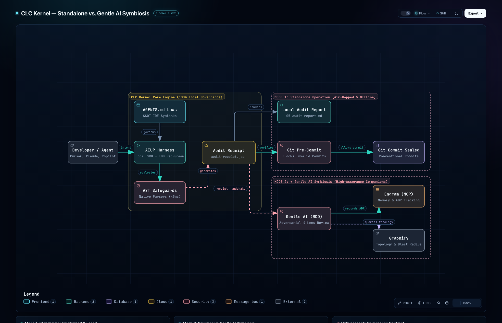
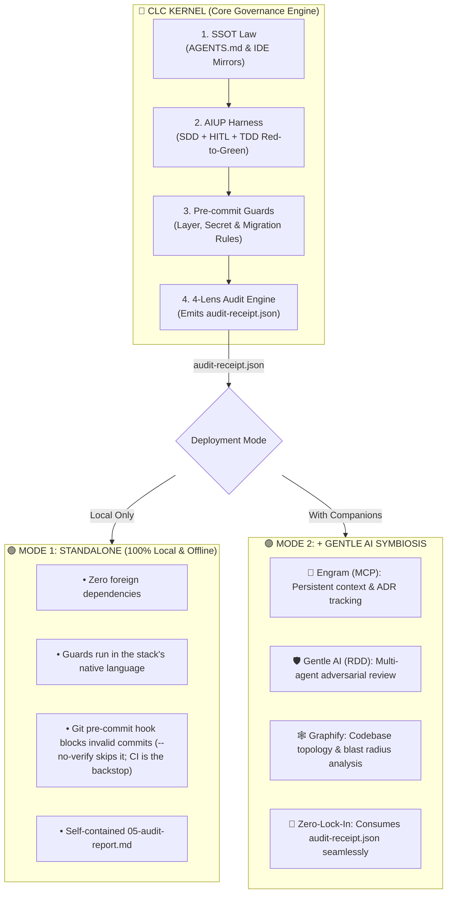

<div align="center">
  

# 🤖 CLC Kernel (`clckernel`)

[](https://www.npmjs.com/package/clckernel)
[](LICENSE)
[](./README.es.md)

**Deterministic AI Agent Governance Engine & AIUP Orchestrator.**
*Forged by [CarlosLeonCode](https://github.com/carlosleoncode).*
</div>

AI coding agents (Cursor, Claude Code, Windsurf, Copilot) code fast, but without guardrails they create architectural decay, tautological tests, and secret leaks. 

**CLC Kernel** is a polyglot developer harness that governs AI agents using **deterministic pre-commit guards** (pattern-based checks, plus Python AST guards on Python stacks), **local SDD specs**, and an enforced **AI Unified Process (AIUP)**.

---

## 📋 Table of Contents
- [🎯 Use Cases](#-use-cases)
- [🏛️ The AI Unified Process (AIUP)](#️-the-ai-unified-process-aiup)
- [🔍 Review-Driven Development (RDD) & the 4 Lenses](#-review-driven-development-rdd--the-4-lenses)
- [⚡ Step-by-Step Guide (Full Lifecycle)](#-step-by-step-guide-full-lifecycle)
- [🧭 What happens after install](#after-install)
- [🎮 Universal Command Interface](#-universal-command-interface)
- [🔄 Updating an Existing Project](#-updating-an-existing-project)
- [⚙️ Configuration (`.clckernel.yaml`)](#configuration)
- [🌐 Supported Stacks & Archetypes](#-supported-stacks--archetypes)
- [⚠️ Known limitations](#known-limitations)
- [🏛️ Architecture: Standalone vs. Gentle AI Symbiosis](#-architecture-standalone-vs-gentle-ai-symbiosis)
- [🧩 Optional Ecosystem Companions](#-optional-ecosystem-companions)
- [📖 Glossary of Key Terms](#-glossary-of-key-terms)
- [🤝 Contributing & Community](#-contributing--community)
- [📄 License](#-license)

---

<a id="use-cases"></a>
## 🎯 Use Cases

| Use Case | Problem It Solves | How CLC Kernel Solves It |
|---|---|---|
| **1. Coding Agent Governance**<br>*(Cursor, Claude Code, Copilot)* | Agents "vibe code", bypass tests, and violate layer boundaries in backend/frontend apps. | Enforces **Rule #0** (Research -> SDD -> TDD Red-to-Green -> Audit) and blocks commits via the pre-commit hook (`--no-verify` skips it; CI is the backstop). |
| **2. Agent-OS & Domain Workflows**<br>*(Autonomous agents and agent runtimes)* | Agent runtimes execute actions without review, invent data, or drift across IDE configs. | Provides **Dual-Layer Governance** and guards for any agent repository: explicit Human-in-the-Loop markers in skills and playbooks (`check_hitl`), SKILL.md frontmatter (`check_skills`), relative links (`check_links`), forgotten placeholders (`check_placeholders`), JSON data files that parse (`check_data_files`) and rule mirrors pointing to AGENTS.md (`check_symlinks`). Domain rules belong to the project: guards in `tools/guards/` run in the hook and the audit. |
| **3. Complex Refactors & Migrations** | Agents modify files outside the agreed feature scope, causing silent regressions. | Anchors work to a local `sdds/{change}/spec.md`; scope is an agent-enforced protocol (not checked by a guard). |
| **4. Shift-Left CI/CD & Pre-commit** | Secret leaks, N+1 query loops, and broken database migrations reach remote branches. | Runs zero-dependency checks in your stack's native language before Git commit: pattern-based guards everywhere, Python AST guards (layers, N+1 heuristic) on Python stacks. |

---

<a id="aiup"></a>
## 🏛️ The AI Unified Process (AIUP)

```
┌─────────────────────────────────────────────────────────────────────────────┐
│                       AI UNIFIED PROCESS (AIUP)                             │
├─────────────┬─────────────┬─────────────┬──────────────────┬────────────────┤
│   1. SDD    │   2. HIT    │   3. TDD    │    4. GUARDS     │   5. MIRROR    │
│ Spec-Driven │ Human-in-the│ Red-to-Green│ Deterministic    │ Single Source  │
│ Development │    Loop     │ Transitions │ Pre-commit Hook  │ of Truth Sync  │
└─────────────┴─────────────┴─────────────┴──────────────────┴────────────────┘
```

1. **SDD (Spec-Driven Development):** Agent must write a local, gitignored specification (`sdds/{feature}/spec.md`) before editing production files.
2. **HIT (Human-in-the-Loop):** The engineer reviews and approves test scenarios and contracts before execution begins.
3. **TDD (Red-to-Green):** Agent must prove failure with a failing regression test (Red Phase) before writing implementation code (Green Phase).
4. **Guards (Deterministic Safeguards):** Pattern-based scripts (and Python `ast` parsers for Python stacks) inspect the staged diff; the pre-commit hook blocks non-compliant commits (`--no-verify` skips it; CI is the backstop).
5. **SSOT (Single Source of Truth):** `AGENTS.md` is forged once and mirrored via filesystem symlinks to `CLAUDE.md`, `GEMINI.md`, `.cursorrules`, `.cursor/rules/clckernel_context.mdc`, `.github/copilot-instructions.md` and `.antigravity/rules.md` (the default `mirrors.list`).

---

<a id="rdd-and-lenses"></a>
## 🔍 Review-Driven Development (RDD) & the 4 Lenses

CLC Kernel structures all verification and audit gates around **Review-Driven Development (RDD)**, with guard results grouped into **4 lenses** by a static name → lens table:

```
┌─────────────────────────────────────────────────────────────────────────────┐
│                     RESULTS GROUPED INTO 4 REVIEW LENSES                    │
├─────────────────────┬───────────────────┬───────────────────┬───────────────┤
│    🎯 CORRECTNESS   │    🛡️ SECURITY    │  🏛️ ARCHITECTURE  │ ⚡ PERFORMANCE│
│ Functional bugs,    │ Secret leaks,     │ Layer violations, │ N+1 heuristic,│
│ scope drift, TDD,   │ permission bypass,│ domain boundaries,│ bundle size,  │
│ API contracts       │ dangerous eval    │ circular deps     │ memory leaks  │
└─────────────────────┴───────────────────┴───────────────────┴───────────────┘
```

`clckernel audit` (or `node tools/audit.js` / `python3 tools/audit.py`) prints the 4-lens summary and writes
nothing. Pass the SDD change it belongs to — `clckernel audit --change <name>` (or
`node tools/audit.js --change <name>`) — and it also writes, in `sdds/<name>/` only:
1. **Human-Readable Educational Report (`05-audit-report.md`):** Explains exactly what passed, failed, warned, or was skipped grouped by lens.
2. **Machine-Readable Audit Receipt (`audit-receipt.json`):** An immutable JSON receipt bound to the active `commitHash` certifying the verdict (`PASSED`, `PASSED_WITH_WARNINGS` or `FAILED`) for automated review gates (such as Gentle AI).

With both orchestrators installed (a mixed JS + Python stack), each writes its own pair so neither overwrites
the other: `05-audit-report.js.md` / `audit-receipt.js.json` and `05-audit-report.py.md` / `audit-receipt.py.json`.

Orchestrator CLI: `audit.(js|py) [targetDir] [--hook] [--change <name>] [--staged]`. `<name>` must be one path
segment (letters, digits, `.`, `_`, `-`); `--staged` spells out the default snapshot (the staged changes, or
the last commit when nothing is staged); `--hook` (used by the pre-commit hook) prints one line per guard and
cannot be combined with `--change`; any other flag exits 2 with the usage. A failing guard whose level is
`warning` — set by the guard (`level: 'warning'` in its result) or by `severities` in `.clckernel.yaml` — is
printed as `WARN` and does not fail the audit or the commit; a guard that crashes always fails.

---

<a id="step-by-step-guide"></a>
## ⚡ Step-by-Step Guide (Full Lifecycle)

```
[1. Terminal]           [2. AI Chat]                 [3. TDD Loop]                 [4. Git Commit]
npx clckernel   ───►   clckernel start   ───►   "Feature X with harness"   ───►   Pre-commit Hooks
(Install)              (Interactive Setup)          (SDD -> HIT -> Tests)         (Guards & Secret Scan)
```

### 1️⃣ Step 1: Bootstrap the Repository (Terminal)
```bash
npx clckernel            # interactive: shows the detected stack and asks before writing
npx clckernel . --yes    # non-interactive (add --dry-run to print the plan only)
```
Auto-detects your framework, generates `AGENTS.md`, creates the AI agent mirrors (symlinks to `AGENTS.md`: `CLAUDE.md`, `GEMINI.md`, `.cursorrules`, `.cursor/rules/clckernel_context.mdc`, `.github/copilot-instructions.md`, `.antigravity/rules.md`), writes the pre-commit hook, and installs native guard scripts in `tools/`. It ends with a **Next steps** block; see [What happens after install](#after-install).

### 2️⃣ Step 2: Initialize in Your AI Chat (Conversational CLI)
Open your AI agent (Claude Code, Gemini CLI, Cursor, Copilot, Antigravity, or any agent that reads `AGENTS.md`) and type:
> `clckernel start`

`start` is an agent command (the CLI rejects it): the agent scans your codebase, proposes an AIUP governance plan tailored to your framework, installs the harness with `npx clckernel . --yes` if it is missing, and writes `.clckernel.yaml` only for settings you want to change (the file is optional). If you keep the defaults, it writes a `.clckernel.yaml` that holds only a comment, which ends the first-session onboarding.

### 3️⃣ Step 3: Develop with the AIUP Harness
When requesting features or bugfixes, instruct your agent:
> *"Add user authentication endpoint. **Follow the CLC Kernel harness**."*

The agent autonomously executes the complete AIUP cycle:
1. **Research & Root Cause Analysis:** Inspects codebase and dependencies.
2. **Local SDD Spec:** Writes API contracts and test plans in `sdds/{change}/spec.md`.
3. **HIT Review:** Requests your review and approval on proposed contracts.
4. **TDD Red Phase:** Writes a failing regression test proving the requirement.
5. **Clean Implementation (Green Phase):** Writes minimal code to pass tests while respecting layer isolation.
6. **Audit Gate:** Runs `node tools/audit.js --change <name>` and outputs the verification summary (report in `sdds/<name>/`).
7. **Journal Entry:** With `check_journal` installed, runs `npx clckernel journal <name>` and fills in the entry from the SDD, committed with the change (see [Journal entries](#journal)).

### 4️⃣ Step 4: Deterministic Guard Verification (Git Commit)
```bash
git add .
git commit -m "feat(auth): add user authentication endpoint"
```
Pre-commit hooks automatically execute the installed guards (e.g. Clean Architecture, Secret Leaks, Migration Reversibility, depending on the stack). Any non-compliant commit is **blocked by the pre-commit hook** (`--no-verify` skips it; CI is the backstop).

The secret scan (`scan_secrets`, on every stack) matches private keys, AWS, Stripe, OpenAI, Anthropic, Google, Slack and GitHub tokens, JWTs, quoted key/secret/password assignments, and secret-named values in committed `.env` files (`.env.example`, `.env.sample` and `.env.template` are skipped). A line that carries the marker `clckernel: allow-secret` (in any comment syntax) is not reported; the marker covers that line only. To keep test fixtures or documentation examples out of the scan, use `guard_exclude` (see [Configuration](#configuration)).

The hook is written to `.githooks/pre-commit` (and `core.hooksPath` is set to `.githooks` in the repository's local git config), or to `.husky/pre-commit` when Husky already runs the repository's hooks. `core.hooksPath` is left unchanged when the directory is not a git repository root or another hook manager owns it; the Next steps block then prints the command that activates the hook. The hook does not list guards: it calls the audit orchestrators (`node tools/audit.js --hook`, `python3 tools/audit.py --hook`, each when installed) and then the stack's external tools (linters, test runners) when they are available. The orchestrators discover every guard — the kernel's and the project's own, either at the top of `tools/` (`check_*`, `scan_*`, `verify_*`, `*_guard`) or in `tools/guards/` — and run each exactly once, so the commit hook and `clckernel audit` always run the same set.

### 5️⃣ Step 5: Verify Repository Health Anytime (Doctor)
```bash
npx clckernel doctor
```
Checks `AGENTS.md`, `sdds/`, `docs/Journal/`, `tools/`, the pre-commit hook, that each guard script loads (JS) or parses (Python), and the audit orchestrators' imports. It does not run the tests.

---

<a id="after-install"></a>
## 🧭 What happens after install

### In the terminal: Next steps
A real install (not `--dry-run`) ends with a **Next steps** block built from what was installed. For a
Next.js project in a git repository it reads:

```text
Next steps
  1. Review and commit the harness: git add -A && git commit -m "chore: install clckernel"
     The pre-commit hook (.githooks/pre-commit) runs on this commit.
  2. Open your AI agent and ask it to run clckernel start to tailor the rules (.clckernel.yaml),
     or just start working: it follows AGENTS.md.
     AGENTS.md mirrors written for: Claude Code (CLAUDE.md), Gemini (GEMINI.md), Cursor, Copilot, Antigravity.
  3. Run npx clckernel audit anytime to see every guard's result.
  4. Project-specific checks go in tools/guards/ (the hook and the audit run them).
  5. Later, preview kernel updates with npx clckernel update --dry-run.
```

- When the hook is not active (no git repository, a subdirectory of the repository, or `core.hooksPath`
  owned by another hook manager), step 1 prints the activation command first, e.g.
  `git init && git config core.hooksPath .githooks`, then the commit.
- In a full-stack or monorepo install, step 1 adds that the hook runs the checks of every part from the
  repository root.
- Step 2 lists only the mirrors this run wrote or found up to date. A file of the same name that is not a
  symlink (your own `CLAUDE.md`, for example) is kept, and that agent reads your file instead of `AGENTS.md`.
  With no mirror written, step 2 says to use an agent that reads `AGENTS.md` itself.
- `clckernel update` prints a shorter Next steps block only when something needs attention: a
  `*.clckernel-new` copy to merge, or guards available with `--add-guards`.

### In your AI agent: the first session
Every AI harness reads the same law: Claude Code (`CLAUDE.md`), Gemini (`GEMINI.md`), Cursor
(`.cursorrules`, `.cursor/rules/clckernel_context.mdc`), Copilot (`.github/copilot-instructions.md`) and
Antigravity (`.antigravity/rules.md`) through the default mirrors; Windsurf through `.windsurfrules` when
it is listed in `mirrors.list` at install time; agents such as Codex or OpenCode read `AGENTS.md` directly.

Every generated `AGENTS.md` ends with a **First session after install** section. It applies while
`tools/.clckernel-managed.json` exists and `.clckernel.yaml` does not:

1. **Your request comes first.** If you ask for a task, the agent does it under the rules and mentions
   onboarding once, in one sentence, at the end.
2. **Otherwise it orients you briefly:** what the kernel installed (`tools/.clckernel-managed.json`) and what
   the pre-commit hook runs on every commit.
3. **It asks ONE question** and waits: tailor the rules now with `clckernel start`, or keep the defaults.
   Keeping the defaults writes a `.clckernel.yaml` that holds only a comment, so the question is not asked
   again.

The `clckernel_cli` skill also triggers in that first session. Projects installed before this section
existed do not get it on `update`: update rewrites only the kernel-owned sections of an existing
`AGENTS.md` (see *AGENTS.md* in [Updating an existing project](#updating-an-existing-project)) and adds the `clckernel update` row to its command
table when missing. To get the section, copy it from a fresh install's `AGENTS.md`.

---

<a id="universal-command-interface"></a>
## 🎮 Universal Command Interface (All LLMs & Agents)

CLC Kernel defines a command grammar in `AGENTS.md`, which the agents read through their mirrors (**Claude Code, Gemini, Cursor, Copilot, Antigravity**; Windsurf when `.windsurfrules` is in `mirrors.list`) or directly (agents that read `AGENTS.md` themselves):

| Command | Category | Mandatory Execution Protocol |
|---|---|---|
| `clckernel feature <name>` | Feature | Full AIUP cycle: Research -> Local Spec (`sdds/{name}/spec.md`) -> HIT review -> TDD Red Phase -> Green Implementation -> Audit. |
| `clckernel fix <issue>` | Bug Fix | Root-cause analysis (no direct code edits) -> Failing regression test -> Surgical clean fix -> Audit gate. |
| `clckernel test` | Verification | Runs repository test suite in the native stack runner and confirms clean pass. |
| `clckernel audit` | Verification | Runs `node tools/audit.js` and/or `python3 tools/audit.py` and emits the Educational Summary; with `--change <name>` it also writes the report and receipt to `sdds/<name>/`. |
| `clckernel doctor` | Diagnostics | Runs `npx clckernel doctor [dir]`: checks AGENTS.md, sdds/, tools/, the pre-commit hook and that the guard scripts load. |
| `clckernel commit <message>` | Version Control | Pre-flight audit, verifies diff vs SDD scope, and commits with Conventional Commits (zero AI attribution). |
| `clckernel guard create <name>` | Safeguards | Scaffolds a new guard script in the stack's native language in `tools/guards/`; the pre-commit hook and the audit run every project guard (`tools/guards/*.js`/`*.py`, and unmanaged `check_*`/`scan_*`/`verify_*` files at the top of `tools/`). |
| `clckernel report-bug <summary>` | Kernel Bug | When the root cause is in a kernel-owned file: never patches it in your project; offers a temporary `.clckernel.yaml` workaround, prepares a bug report and explains the fork + pull request path (or an issue), with your approval at each outward step. |
| `clckernel update` | Maintenance | Non-destructive update: refreshes core tools, skills & IDE symlinks without overwriting SDDs, custom guards, or `.clckernel.yaml`. |
| `clckernel start` | Setup | Agent command: auto-detects the stack, proposes the AIUP lifecycle, installs the harness (`npx clckernel . --yes`) if missing; `.clckernel.yaml` is optional and written only for non-default settings (keeping the defaults writes a comment-only file). |

---

<a id="updating-an-existing-project"></a>
## 🔄 Updating an Existing Project (Non-Destructive)

When new versions of CLC Kernel are released with new guards, upgraded playbooks, or improved IDE rules, update your project safely without losing your work:

```bash
npx clckernel update
```
Or from your AI agent chat:
```bash
clckernel update
```

### 🔒 The Non-Destructive Update Guarantee:
- **Refreshes & Upgrades:** Core orchestrators (`tools/audit.js`, `tools/audit.py`), the built-in guards your project has, Agent Skills (`.agents/skills/`), and the IDE symlinks your project has (`CLAUDE.md`, `GEMINI.md`, `.cursorrules`, Copilot, Antigravity).
- **100% Preserved:**
  - `sdds/`: All local specifications, plans, and verification receipts remain intact.
  - Project guards (`tools/guards/`, and guard files at the top of `tools/` the kernel does not own) are preserved without modification. A kernel guard the kernel no longer ships stays exactly where it is, leaves the registry and keeps running as a project guard; `update` reports it as a "retired kernel guard kept as project guard".
  - `.clckernel.yaml`: never rewritten; update reads it (see [Configuration](#configuration)).
  - Application source code and domain models are never touched.

### 🛡️ Files you edited are never overwritten
`update` (and a reinstall with `--yes`) only overwrites a kernel file (`tools/*`, the pre-commit hook, the
`clckernel_cli` skill) when it can prove the file is its own and intact: its sha256 matches the registry
(`tools/.clckernel-managed.json`) or a version the kernel published. Anything else — a guard you hardened, a
project file that happens to share a kernel file's name — is kept byte for byte, and the new version is
written next to it as `<file>.clckernel-new` (gitignored) for you to review and merge. The summary lists what
was written, unchanged, protected, moved, added to `.gitignore` and set in `git config`.

Preview first with `--dry-run`: it prints the same summary as a plan and writes nothing (no files,
`.gitignore` or `git config`):
```bash
npx clckernel update . --dry-run
npx clckernel . --yes --dry-run
```

### ➕ Update never adds what you did not choose
`update` refreshes what the project already has; it never adds guards or IDE mirrors on its own:
- **Guards:** only the guards in the registry or present in `tools/` are refreshed and run by the hook. New
  guards of your stack are listed as *available, not installed*; opt in with `--add-guards` (they stay
  installed and updated from then on). `--add-guards` accepts any bundled guard of the catalog, also one
  your stack does not install (e.g. `check_api_contracts`, `check_storybook`, `check_scope`): update warns
  that it is not part of the detected stack, records it in the registry (`extraGuards`) and refreshes it
  like the others. A name outside the catalog (or an external CLI) fails with exit 1 and writes nothing.
- **Technologies detected since the last run:** the one exception. The registry records the technologies
  detected at install/update (`technologies`); one that appeared since (a `Dockerfile`, a
  `supabase/config.toml`, a data client or the MCP SDK in a `package.json`) brings its guard, listed as
  *added for newly detected technologies* (`--dry-run`: *would add*). A registry written by an older release
  has no list: that update records the current technologies as the baseline and adds nothing (their guards
  are listed as available, add them with `--add-guards`). A guard you remove stays removed. Support files
  (`_changes.js/.py`, the config readers `_config.js/.py`, `yaml.js`, `_yaml.py`, the audit orchestrators,
  `tools/package.json`) follow the installed guards.
- **Mirrors:** a mirror you deleted (e.g. `.cursor/rules/clckernel_context.mdc`) is not recreated; it is
  reported as *not present (skipped)*. A fresh install still creates them all.
- **AGENTS.md:** the kernel-owned sections are the *Parts* table and *Core AI Safeguards* of a full-stack or
  monorepo `AGENTS.md`, or section *2. Core AI Safeguards (<stack>)* of a single stack. Their safeguard lines
  follow the guards installed (a guard you removed is not promised; one added with `--add-guards` is listed).
  The registry records a sha256 of each section as the kernel wrote it (`agentsSections`). `update` rewrites a
  section only when its text still has that hash, or already equals the new text. If you edited one, or an
  older install recorded no hash and the text differs, `AGENTS.md` is kept as it is and the refreshed file is
  written next to it as `AGENTS.md.clckernel-new` for you to merge (listed as protected). Every other section
  is never touched, a document without those headings is left alone, `update.exclude: [AGENTS.md]` keeps it
  out entirely, and `--dry-run` writes nothing.
- **`.gitignore`:** an entry whose path git tracks (a mirror or the skill you commit) is never added, on
  install or update; it is reported as *tracked, not ignored*.
```bash
npx clckernel update . --add-guards check_skills,check_placeholders
npx clckernel update . --add-guards all
```

### 🆕 What is new since your version
The registry records the kernel version of the last install or update (`kernelVersion`). `update` lists each
bundled guard released after it in a *New since <installed> (<current>)* section, after *available, not
installed*: what it checks, `[blocks commits]` when its default level blocks a commit, `(installed)` when the
project already has it, what to check before adopting it, and the `--add-guards` command that adds it. Nothing
is installed on its own. A registry without `kernelVersion`, or a project already on the current version,
gets no such section.

For agents, `--json` (with or without `--dry-run`) prints one JSON object on stdout instead of the text (no
banner, no colors): `contract` (`clckernel.update-plan/v1`), `success`, `dryRun`, `kernelVersion`
(`installed`, `current`), `plan`, `whatsNew` (`name`, `since`, `checks`, `blocking`, `adopt`, `installed`,
`inStack`, `command`), `warnings`, `preserved`, `retiredGuards`, `legacyCleanup` and `nextSteps`. An error
prints `{ contract, success: false, error }` and exits 1. The `update` playbook runs `--dry-run --json`,
reviews each new guard with you and adds only the ones you approve.
```bash
npx clckernel update . --dry-run --json
```

<a id="journal"></a>
### 📓 Journal entries (optional: `check_journal`)
`sdds/` is gitignored, so the *why* of each change stays on the machine that wrote it. The journal is the
committed record: one short Markdown file per audited SDD change, `docs/Journal/<YYYY>/<YYYYMMDDTHHMMZ>-<change>.md`
(UTC timestamp, so the names sort by date and two branches do not collide), with a frontmatter `change:` and
`date:` and four sections: `## Context`, `## Decision`, `## Alternatives`, `## Consequences`. There is no
index: an agent lists the year folder and reads the entries that touch the area it works on. The numbered ADRs
already in `docs/Journal/` stay as they are.

`npx clckernel journal <change> [targetDir]` creates the entry from a template (the `<change>` name follows the
`audit --change` rule) and refuses a change that already has one; you or your agent fill it in from the SDD.
The `check_journal` guard is not installed by default: add it with
`npx clckernel update . --add-guards check_journal`. Then, for each `sdds/<change>/audit-receipt*.json` whose
`commitHash` is the current HEAD (the audited change you are about to commit), the hook blocks the commit
until that change's entry is in the index or in HEAD, and every staged entry under `docs/Journal/<YYYY>/` must
have a valid name, its `change:`, the four sections and at most `journal.max_lines` lines. Receipts of other
commits are ignored, so adopting it asks nothing for earlier changes; adopt it between changes. The receipts
are local: without `sdds/` (CI, a fresh clone) the guard is skipped and says so.
```bash
npx clckernel journal add-cache .
```

---

<a id="configuration"></a>
## ⚙️ Configuration (`.clckernel.yaml`)

Optional. Without the file every default below applies (it is the behaviour of a project without
config). Install, update and every guard read it from the project root; an invalid value stops them
with `Invalid .clckernel.yaml: key "<key>" — <reason>` (nothing is written, the commit is blocked).

| Key | Effect | Default | Read by |
|---|---|---|---|
| `rules` | Custom regex rules (`name`, `pattern`, `message`, optional `severity`, `scope`, `exclude`) run against the changed files | none | `check_custom` |
| `exclude_paths` | Globs no diff-based guard evaluates (secret scan, TDD verifier, custom rules, …): every guard loses them; to silence one guard, prefer `guard_exclude` | none | `_changes.js/.py` |
| `mirrors.list` | AI IDE mirrors (symlinks to `AGENTS.md`) install creates and `check_symlinks` verifies | install: `CLAUDE.md`, `GEMINI.md`, `.cursorrules`, `.cursor/rules/clckernel_context.mdc`, `.github/copilot-instructions.md`, `.antigravity/rules.md`; `check_symlinks`: `CLAUDE.md`, `GEMINI.md`, `.cursorrules`, `.windsurfrules` | install/update, `check_symlinks` |
| `mirrors.required` | `true`: a listed mirror that is missing fails `check_symlinks` | `false` | `check_symlinks` |
| `hitl.markers` | Regexes (case-insensitive, one line, outside code fences) that count as a Human-in-the-Loop marker; they replace the defaults | a `HITL:` line or a `## Human checkpoint` / `## HITL` heading | `check_hitl` |
| `hitl.paths` | Globs of the changed files `check_hitl` evaluates | skills (`SKILL.md`, flat `skills/*.md`) and `playbooks/**/*.md` | `check_hitl` |
| `hitl.optOut` | `{ key, value }`: a file whose frontmatter has `key: value` is exempt | none | `check_hitl` |
| `update.exclude` | Root-relative globs install and update never write, move or remove; listed as *excluded by config* | none | install/update |
| `tdd.code` | Extra globs counted as production code (any language), e.g. Python tools tested by JS tests | none | `verify_tdd.js/.py` |
| `tdd.ignore` | Globs left out of the red→green check, code or test (e.g. `e2e/**` for specs another runner owns); setting the key replaces the default | generated code: `**/database.types.ts`, `**/*.generated.*`, `**/*.gen.*`, `**/__generated__/**`, `**/generated/**` | `verify_tdd.js/.py` |
| `severities` | `{ <guard name>: warning \| error }`: a failing guard at `warning` is reported (`WARN`, verdict `PASSED_WITH_WARNINGS`) but does not block; `error` blocks even when the guard reports `level: 'warning'`. A crash always blocks | each guard's own level (`error` unless it reports `warning`) | `audit.js` / `audit.py` (audit and pre-commit hook) |
| `guard_exclude` | `{ <guard name>: [globs] }`: changed files that one guard never evaluates; every other guard still sees them. The guard name is its file name without extension (`scan_secrets`, `check_custom`, a `tools/guards/` guard's own name); any name is accepted | none | `_changes.js/.py`, for the guard the audit orchestrators (or a direct run) name |
| `sql_migrations.paths` | Globs of the SQL migration files; a configured folder that exists also installs the guard | `**/supabase/migrations/**/*.sql` | `check_sql_migrations`, install/update |
| `sql_migrations.schemas` | Schemas whose `create table` needs `enable row level security` in the same file | `public` | `check_sql_migrations` |
| `sql_migrations.anon_roles` | Roles that must get no `insert` / `update` / `delete` / `all` grant | `anon` | `check_sql_migrations` |
| `sql_migrations.severities` | `{ immutable, rls, search_path, anon_write, destructive }`: `error`, `warning` or `"off"` (quoted: a bare off is rejected) per rule | `destructive: warning`, the rest `error` | `check_sql_migrations` |
| `query_efficiency.call_patterns` | Extra regexes of query calls (matched on code with comments and literal text blanked), for any file | none (the presets follow the file's data client) | `check_query_efficiency` |
| `query_efficiency.severities` | `{ n_plus_one, unbounded_select }`: `error`, `warning` or `"off"` (quoted) | both `warning` (`n_plus_one` is a heuristic; set `error` to block) | `check_query_efficiency` |
| `mcp_contracts.contracts_modules` | Modules (and their subpaths) tool input schemas must be imported from; configuring it turns on `inline_schema` and `schema_source` | none: any schema, inline or local, passes | `check_mcp_contracts` |
| `mcp_contracts.forbid_data_clients` | `true`: a file that registers tools may not import a data client | `false` | `check_mcp_contracts` |
| `mcp_contracts.severities` | `{ missing_schema, inline_schema, schema_source, data_client }`: `error`, `warning` or `"off"` (quoted) | all `error` | `check_mcp_contracts` |
| `ui_reuse.primitives` | Globs of the UI primitives, exempt from the raw `<button>` / `<input>` / `<select>` rules | `**/components/ui/**` | `check_ui_reuse` |
| `journal.dir` | Folder of the journal entries (`<dir>/<YYYY>/<YYYYMMDDTHHMMZ>-<change>.md`), inside the project | `docs/Journal` | `check_journal`, `clckernel journal` |
| `journal.max_lines` | The most lines a journal entry may have (a positive integer) | `80` | `check_journal` |

```yaml
exclude_paths: ["vendor/**"]
mirrors:
  list: [CLAUDE.md, .github/copilot-instructions.md]
  required: true
hitl:
  optOut: { key: checkpoint, value: none }
update:
  exclude: [AGENTS.md]
tdd:
  code: ["tools/**/*.py"]
severities:
  check_seo: warning
guard_exclude:
  scan_secrets: ["tests/**", "**/tests/**", "**/*.md"]
sql_migrations:
  severities: { destructive: "off" }
mcp_contracts:
  contracts_modules: ["@acme/contracts"]
```

Prefer `guard_exclude` over `exclude_paths` when only one guard misfires on some paths: with
`exclude_paths: ["tests/**"]` the TDD verifier would stop seeing test changes too, while
`guard_exclude: { scan_secrets: ["tests/**"] }` keeps fake credentials in test fixtures out of the
secret scan alone. Like `exclude_paths`, it filters the changed files a guard evaluates, not the
repository-wide file listing some guards check facts against (a link target, a project marker).

Keys earlier releases accepted without any effect — `active_guards`, `phases`, `gate_mode`,
`layers`, `scope` — are ignored with a deprecation warning; remove them. An unknown top-level key is
ignored with a warning. The guards read it through `tools/_config.js` (+ `yaml.js`) and `tools/_config.py`
(+ `_yaml.py`), installed next to `_changes.js/.py`, so a file created after install applies at once.

---

<a id="supported-stacks"></a>
## 🌐 Supported Stacks & Archetypes

| Ecosystem | Detection Signature | Test Runner | Native Safeguards |
|---|---|---|---|
| ⚛️ **Next.js** | `next` | Vitest / Jest | Clean Arch, UI Reuse, Semantic Tokens, RSC, A11y, Responsive, SEO |
| ⚡ **FastAPI** | `fastapi` | Pytest | Alembic Migration Reversibility, Clean Arch (Python AST), N+1 Heuristic (Python AST), Red→Green TDD Verifier (pytest) |
| 💎 **Rails** | `Gemfile` | RSpec | RuboCop, Brakeman Security, Red→Green TDD Verifier (RSpec / Minitest) |
| 🐹 **Golang** | `go.mod` | `go test` | `golangci-lint`, Domain/UseCase Layer Isolation, Red→Green TDD Verifier (`go test`) |
| 🦀 **Rust** | `Cargo.toml` | `cargo test` | `cargo clippy`, `cargo audit`, Strict Memory Safety, Red→Green TDD Verifier (`cargo test`, integration tests) |
| 🐘 **Laravel** | `artisan` | Pest / PHPUnit | PHPStan static analysis, Red→Green TDD Verifier (Pest / PHPUnit) |
| 🎸 **Django** | `manage.py` | `pytest-django` | Ruff, Clean Arch (Python AST), N+1 Heuristic (Python AST), Red→Green TDD Verifier (pytest) |
| 🚀 **Astro** | `astro.config` | Playwright | Tailwind v4 Tokens, Content Schema, A11y, Responsive, SEO |
| 🤖 **Agent-OS** | `skills/<name>/SKILL.md` (also `.agents/skills/`, `.claude/skills/`), `playbooks/` or `rules/` with Markdown; a code stack in the same repo wins | Contract Tests | Dual-Layer AGENTS.md, HITL markers (`check_hitl`), Skills (`check_skills`), Links (`check_links`), Placeholders (`check_placeholders`), JSON data (`check_data_files`), Mirrors (`check_symlinks`), Custom rules (`check_custom`); project guards in `tools/guards/` |

### 🧱 Full-stack & monorepos

A repository can hold several code parts. `clckernel` looks for a stack in the root, in the directories
declared as workspaces (`package.json#workspaces`, array or `{ packages }`, `pnpm-workspace.yaml`
`packages:`, `lerna.json` `packages` and `go.work` `use`) and in the conventional directories `frontend`,
`backend`, `web`, `api`, `server`, `client`, `apps/*`, `services/*`, `packages/*` and `libs/*` (at most
three levels deep; `node_modules`, `.git`, `vendor`, `dist` and `build` are skipped). Workspace patterns are
read as literal directories, `*` segments (`dir/*`, `dir/*/*`) or a trailing `dir/**`, which descends until a
directory holding a package manifest; other glob forms are ignored, and so are directory names with
characters other than letters, digits, `.`, `_` and `-` (e.g. `@scope`).

- **One part at the root:** installed exactly as a single-stack repository.
- **Several parts** (e.g. Next.js at the root + `backend/` FastAPI, or `apps/web` + `apps/api`): the project
  type is `fullstack` (a part at the root) or `monorepo` (only subdirectories). Two stacks of the same
  ecosystem in one directory (e.g. FastAPI and Django) stay one part, the first adapter winning as before.
- **Library parts:** a subdirectory with a package manifest that no framework adapter matches is a library
  part of its ecosystem, and counts as a part on its own (a repository of libraries only is a `monorepo`;
  Next.js at the root plus `packages/ui` is `fullstack`):

  | Part | Manifest | Hook tools (inside the part) |
  |---|---|---|
  | `TypeScript Library` | `package.json` (or an Nx `project.json`) + `tsconfig.json` | `tsc --noEmit` (its own `node_modules/.bin/tsc`, else the root's) |
  | `JavaScript Library` | `package.json` or an Nx `project.json` | none: the JS guards only |
  | `Python Library` | `pyproject.toml`, `setup.py` or `setup.cfg` | `ruff`, `pytest` (exit 5, no tests collected, passes) |
  | `PHP Library` | `composer.json` (no `artisan`) | `vendor/bin/phpstan`, `vendor/bin/pest` else `vendor/bin/phpunit` |
  | `Ruby Library` | `*.gemspec` or `Gemfile` (no `config/routes.rb`) | `rubocop`, `rspec` (from `Gemfile.lock`), else Minitest via `rake test` |

  Go modules and Rust crates are already parts through their own adapters. The root is never a library part,
  so a single-package repository is detected as before. A `JavaScript Library` is dropped when another node
  part (Next.js, Astro, a TypeScript library) already installs the JS guards, because it adds nothing, so a
  Next.js root with plain JS workspace packages stays single-stack. An Agent-OS root whose only parts would
  be libraries stays Agent-OS. A root `Cargo.toml` with `[workspace]` is one part: `cargo test` and
  `cargo clippy` at the root already cover the member crates, so members are not separate parts.
- **Guards:** the union of the parts' guards is installed once in the root `tools/`, with one audit
  orchestrator per guard language, and runs once from the root.
- **External tools** (ruff, pytest, tsc, …) run inside their part's directory; a missing one prints
  `clckernel: <tool> (<dir>) not available, skipped`.
- **Red→Green TDD Verifier:** each changed file belongs to its nearest project root (Python:
  `pyproject.toml`, `requirements.txt`, `setup.cfg`, `setup.py`, `manage.py`; JS: `package.json`; Go: `go.mod`;
  Rust: `Cargo.toml`; Ruby: `Gemfile`; PHP: `composer.json`). Each group runs in its root (`PYTHONPATH`, runner
  and `node_modules` of that root, or the repository root's `node_modules` when hoisted). Code changed in a part
  without a changed test in that same part fails.
- **AGENTS.md** lists every part (directory, stack, test runner) with each stack's rules; `clckernel update`
  re-detects the parts.

<a id="red-green-other-stacks"></a>
#### Red→Green on Go, Rust, Ruby and PHP

`tools/verify_tdd.js` (Node is present on every stack) runs the changed tests on the staged code (must pass,
with at least one test executed) and on `HEAD` plus those tests (must fail), from trees materialized from git:

| Language | Tests | Production code | Command |
|---|---|---|---|
| Go | `*_test.go` | other `.go` (not `vendor/`) | `go test -v -count=1 ./<pkg>…` (packages of the changed tests) |
| Rust | `tests/*.rs`, `tests/<t>/main.rs` | `src/**/*.rs` | `cargo test --test <t>…` (temporary `CARGO_TARGET_DIR`) |
| Ruby | `spec/**/*_spec.rb`, `test/**/*_test.rb` | `app/**/*.rb`, `lib/**/*.rb` | `bundle exec rspec` / `bundle exec ruby -Ilib -Itest` |
| PHP | `tests/**/*Test.php` | `app/**/*.php`, `src/**/*.php` | `vendor/bin/pest`, else `vendor/bin/phpunit` (one file per run) |

A missing `go`, `cargo`, `bundle`, locked `rspec-core` (for specs) or `vendor/bin/{pest,phpunit}` fails the
check with an install hint. Limitations: Rust `#[cfg(test)]` unit tests live inside the code file and cannot be
separated for the red run, so a `src/` change needs a changed integration test under `tests/` (or a
`tdd.ignore` entry); Minitest runs through plain `ruby -Ilib -Itest`, not `rails test`; Go is verified per
package; PHP assumes Composer 2.2+ bin proxies. Only committed or staged files exist in the trees (no `.env`).

<a id="technology-guards"></a>
#### Technology guards

Install and `update` also look for technologies in the root and in every part, and add their guard (JS,
stack-agnostic; listed in the install summary and in AGENTS.md):

| Technology | Detected by | Guard |
|---|---|---|
| Supabase / SQL migrations | `supabase/config.toml`, or a configured `sql_migrations.paths` folder | `check_sql_migrations` |
| Database client | `@supabase/supabase-js`, `drizzle-orm`, `@prisma/client`, `postgres` or `pg` in a `package.json` | `check_query_efficiency` |
| MCP server | `@modelcontextprotocol/sdk` in a `package.json` | `check_mcp_contracts` |
| Celery, Redis, PostgreSQL (Python), Docker | Python dependencies, `redis.conf`, `Dockerfile`, `docker-compose.yml` | `celery_guard`, `redis_guard`, `postgres_guard`, `docker_guard` |

- **`check_sql_migrations`** reads the changed migration files statement by statement (comments, string
  literals and dollar-quoted bodies blanked; case-insensitive): an applied migration that is modified, deleted
  or renamed (`immutable`; applied = present at the merge-base with the branch's upstream when it has one,
  else at BASE, so a migration you only committed locally may still change); a `create table` in a checked schema without `enable row level security`
  in the same file (`rls`); a `security definer` function or procedure without `set search_path`, in its `create` or a later
  `alter function … set search_path` (`search_path`);
  `insert`/`update`/`delete`/`all` granted to an anonymous role, `alter default privileges` included
  (`anon_write`); `drop table` / `drop [column]`, named (`destructive`, a warning). Unqualified names resolve to
  the first schema of the last `set search_path` in the file (public without one); quoted identifiers keep
  their case (`"Items"` is not `items`). Not seen: SQL built in `EXECUTE` strings, RLS enabled in another
  migration.
- **`check_query_efficiency`** (the JS/TS counterpart of `check_db_efficiency`) reads changed JS/TS files whose
  nearest `package.json` (or the root one) depends on a client: a query call awaited in a `for` / `for…of` /
  `for await` / `while` / `do` body, or any query call in a `.forEach(` / `.map(async` / `.flatMap(async`
  callback, is an N+1 warning (a heuristic: set `query_efficiency.severities.n_plus_one: error` to block);
  a statement that paginates (`.range(`, `.offset(`, `.skip(`, `skip` / `offset` / `cursor`, SQL `OFFSET`) and
  a call inside a function defined in the loop body (a handler registered per route) are not N+1. Statements
  end at `;` or at a line break that does not continue them. supabase-js `.select('*')` without `.limit(` / `.range(` / `.single(` /
  `.maybeSingle(` is a warning. Calls: supabase-js `.from(…).select|insert|update|upsert|delete(` and `.rpc(`;
  drizzle `db.`/`tx.` `select|insert|update|delete|execute(` and `db.query.<t>.findMany|findFirst(`; prisma
  `prisma.<model>.<operation>(`; postgres `` sql`…` ``; pg `client|pool|db.query(`. Test files and generated
  types are skipped (`tdd.ignore`'s default generated-file globs). Known false positives: a loop that runs a
  few fixed times, a batch call that is a single query. Not seen: a query helper called inside a loop, a query
  inside any callback other than `.forEach` / `.map` / `.flatMap` in a loop, a client under another variable
  name, `.select()` without arguments.
- **`check_mcp_contracts`** reads changed JS/TS files of packages that depend on the MCP SDK. A registration is
  `<x>.registerTool("name", { inputSchema, … }, cb)` (the SDK's current API, checked against
  `@modelcontextprotocol/sdk` 1.32) or the deprecated `<x>.tool("name", …)`. By default it only requires an
  input schema per tool (`missing_schema`). With `mcp_contracts.contracts_modules` configured, an inline
  schema (`z.object(…)`, `z.*`, a raw shape with zod members) fails (`inline_schema`) and a schema identifier
  not imported from those modules fails (`schema_source`); with `mcp_contracts.forbid_data_clients: true`, a
  file that registers tools and imports a data client (type-only imports included) fails (`data_client`). Not followed: a config object passed as a variable,
  a schema re-exported through a local module.

Not supported: Agent-OS as one part of a monorepo, nested git repositories or submodules, choosing parts by
hand in the interactive prompt ("Choose another stack" installs a single stack), and Composer path
repositories (PHP parts are found only through workspaces of other tools and the conventional directories).

---

<a id="known-limitations"></a>
## ⚠️ Known limitations

- **Windows is not tested.** The pre-commit hook is a shell script (`#!/usr/bin/env bash`, or `sh` under
  Husky): on Windows it needs a bash/sh such as Git Bash.
- **Kernel files declare themselves to your linters; formatters are not covered.** Every JS and Python file the
  kernel writes into `tools/` starts with file-level pragmas: `/* eslint-disable */` (ESLint, oxlint),
  `// biome-ignore-all lint:` (Biome 2) and `// @ts-nocheck` (TypeScript `checkJs`); `# ruff: noqa`,
  `# flake8: noqa`, `# pylint: skip-file`, `# mypy: ignore-errors`, `# isort: skip_file` and `# fmt: off`
  (black, ruff format). Your linter config needs no `tools/` ignore, and `tools/guards/` (your code) stays
  linted. Gaps: Prettier and Biome's formatter have no file-level opt-out, so list the paths in
  `tools/.clckernel-managed.json` in `.prettierignore` / Biome's `files.includes` if they format `tools/`;
  ESLint 9 reports a blanket `eslint-disable` that suppresses nothing as a warning and `eslint --fix` (e.g. from
  lint-staged) deletes it (only when your config reports nothing in that file); ruff's `PGH004` (selected by `ALL`) reports the
  blanket `noqa`.
- **Projects with `"type": "module"`.** The guards run as CommonJS whatever the project's module type: when
  install or update puts a JS file in `tools/`, it also writes `tools/package.json` (`{ "type": "commonjs" }`),
  a kernel-owned file listed in the registry. A `tools/package.json` of your own is kept (the kernel's version
  goes to `tools/package.json.clckernel-new`); if yours sets `"type": "module"`, `npx clckernel doctor` fails
  the *tools/ JS runs as CommonJS* check and tells you what to change. Project guards in `tools/guards/` are
  CommonJS too.
- **Rust inline unit tests** (`#[cfg(test)]`) cannot be separated for the red run; see
  [Red→Green on Go, Rust, Ruby and PHP](#red-green-other-stacks).
- **Existing installs keep most of their `AGENTS.md`.** `update` refreshes only the parts table and the
  safeguard lists (section 2), and only while you have not edited them, so the *First session after install* section and other template changes reach
  only fresh installs; copy them by hand if you want them.
- **Technology guards are heuristics on source text**, not parsers: see [Technology guards](#technology-guards)
  for what each one does not see. They are JS guards, so a Python-only stack with Supabase needs Node at
  commit time (it has it: the CLI runs with npx).
- **Windsurf has no default mirror.** List `.windsurfrules` in `mirrors.list` before installing; on an
  existing install `update` does not add mirrors, so create it yourself (`ln -s AGENTS.md .windsurfrules`).
- **External linters and test runners run only when available.** The hook runs each one (tsc, ruff, pytest,
  golangci-lint, cargo, …) when the project has it at commit time and otherwise prints
  `clckernel: <tool> not available, skipped`; the guards in `tools/` always run.

---

<a id="architecture-symbiosis"></a>
## 🏛️ Architecture: Standalone vs. Gentle AI Symbiosis

CLC Kernel is architected with a **zero-lock-in philosophy**: it functions as a 100% self-sufficient local governance engine, while offering seamless, native interoperability with the [Gentle AI](https://github.com/Gentleman-Programming/gentle-ai) ecosystem.

<div align="center">
  
</div>

> 💡 *Interactive Diagram: Built with [Archify](https://github.com/tt-a1i/archify). Open [`docs/Architecture/clckernel-symbiosis.html`](./docs/Architecture/clckernel-symbiosis.html) for full trace animation, theme switching, and deep-link node inspection.*



---

<a id="ecosystem-companions"></a>
## 🧩 Optional Ecosystem Companions

CLC Kernel focuses strictly on governance and runs with **zero foreign dependencies**. It seamlessly integrates with companion tools:
- 🧠 **[Engram (MCP)](https://github.com/Gentleman-Programming/gentle-ai):** Persistent architectural memory and ADR tracking across agent sessions.
- 🕸️ **[Graphify](https://github.com/carlosleoncode/graphify):** Visual dependency graphs and codebase topology mapping.
- 🛡️ **[Gentle AI (RDD)](https://github.com/Gentleman-Programming/gentle-ai):** Multi-lens adversarial code review gate.

---

<a id="glossary"></a>
## 📖 Glossary of Key Terms

| Term | Definition |
|---|---|
| **SDD** *(Spec-Driven Development)* | A specification-first methodology where detailed technical contracts, schemas, acceptance criteria, and test scenarios are authored in local, gitignored specs (`sdds/{change}/spec.md`) before modifying source code. |
| **RDD** *(Review-Driven Development)* | An adversarial and structured code verification methodology where changes are audited across four orthogonal lenses (Correctness, Security, Architecture, Performance) to ensure systematic quality gates before merge or commit. |
| **AIUP** *(AI Unified Process)* | The end-to-end governed lifecycle implemented by CLC Kernel: Research $\rightarrow$ Local SDD $\rightarrow$ Human-in-the-Loop (HITL) approval $\rightarrow$ TDD Red-to-Green $\rightarrow$ Guard Audit Gate $\rightarrow$ Conventional Commit. |
| **HIT / HITL** *(Human-in-the-Loop)* | A mandatory approval gate where a human engineer validates contracts, architecture decisions, and proposed tests before an autonomous agent executes production code edits. |
| **TDD** *(Test-Driven Development)* | The engineering practice of writing a failing automated regression test (Red Phase) to reproduce an issue or specify a new feature before writing the minimal production code to make it pass (Green Phase). |
| **Guard** *(Safeguard script)* | A lightweight, zero-dependency check in the stack's native language, run by the pre-commit hook. Most guards are pattern-based (regex); on Python stacks the layer, N+1 and Celery/Redis/Postgres guards parse code with Python `ast`. The hook blocks violations before commit (`--no-verify` skips it; CI is the backstop). |
| **SSOT** *(Single Source of Truth)* | The centralized governance principle where `AGENTS.md` acts as the single source of truth, mirrored to the AI agent rule files (`CLAUDE.md`, `GEMINI.md`, `.cursorrules`, `.cursor/rules/clckernel_context.mdc`, `.github/copilot-instructions.md`, `.antigravity/rules.md`; configurable with `mirrors.list`) via filesystem symlinks. |
| **Audit Receipt** | An immutable, machine-readable JSON artifact (`audit-receipt.json`) produced by the audit engine containing the timestamp, commit hash, per-lens verdicts, and Gentle AI RDD compatibility metadata. |
| **ADR** *(Architectural Decision Record)* | A standardized document in `docs/Journal/` capturing significant architectural decisions, context, evaluated alternatives, and consequences. |
| **Agent-OS** | An operating system archetype for non-tech domain workflows (e.g. Research OS, Support Ops, Operations OS) made of skills, playbooks, rules, prompts and templates, governed by a dual-layer AGENTS.md, explicit HITL checkpoints and document guards (skill frontmatter, links, placeholders). |

---

### Found a bug in CLC Kernel itself?
If the problem is in a kernel guard, the hook, the audit orchestrators, the CLI or the skill (not in your code or your own guards), ask your agent for `clckernel report-bug <summary>`. It does not patch the kernel file in your project (`update` would keep the edit and the fix would never reach the kernel); it offers a temporary `.clckernel.yaml` workaround (`severities`, `exclude_paths`, `update.exclude`, `tdd.ignore`), writes a bug report with a minimal reproduction, and explains how to fix it upstream: fork the repository, open it with your own AI agent (Claude Code, Antigravity, Cursor, Copilot, Gemini…) and send a pull request, or open an [issue](https://github.com/CarlosLeonCode/clc_forge/issues). It never forks, pushes or opens anything without your approval. See [CONTRIBUTING.md](CONTRIBUTING.md#found-a-bug-while-using-clc-kernel-in-your-project).

## 🤝 Contributing & Community
Contributions are welcome. Start with these documents:

- [CONTRIBUTING.md](CONTRIBUTING.md) — setup, the pre-commit hook, tests and the pull request flow.
- [CODE_OF_CONDUCT.md](CODE_OF_CONDUCT.md) — expected behavior and how to report a problem.
- [SECURITY.md](SECURITY.md) — how to report a vulnerability privately.
- [CHANGELOG.md](CHANGELOG.md) — notable changes per release.

<a id="license"></a>
## 📄 License
Copyright © 2025-2026 [CarlosLeonCode](https://github.com/carlosleoncode). See [NOTICE](NOTICE).

- **The kernel is AGPL-3.0-only.** The CLI, its source and this repository are licensed under the GNU Affero
  General Public License v3 only — see [LICENSE](LICENSE).
- **Files installed into your project are yours to use under your project's license.** The guards, hook,
  `AGENTS.md`, configuration and skill files that CLC Kernel writes into your project can be used, changed and
  shipped as part of that project under its own terms, per the
  [Installed Files Exception](LICENSE-EXCEPTION.md).
- **The name and logo are trademarks.** Their use is covered by [TRADEMARKS.md](TRADEMARKS.md); forks need
  their own name and logo.

Releases up to and including 2.0.4 were published under the MIT License and remain available under MIT.
